# StockRoom — a warehouse app built lab by lab

StockRoom is a .NET MAUI (C#, MVVM) mobile app for running a small warehouse.
It is also a **teaching project**: it is built one lab at a time for the
*Mobile Development (.NET MAUI)* course, and the repository records every step
of building mobile software, from a single MVVM form to an offline-first app
backed by a database.

## What we are building

A deliberately **simple** warehouse app: one warehouse, three people, three
roles, about ten products. It does four things:

- shows the **product list** with characteristics and quantity on hand;
- **sorts** the list by any characteristic;
- lets the manager **add products and characteristics**;
- **scans a barcode**, then the user chooses **In** or **Out** and enters the
  **number of units**. A barcode identifies a product (a kind of unit), so
  one scan can record many units.

Users **sign in with a login and a password** (stored only as a salted hash) and the role decides what they may do.
Around these it behaves like a real mobile app: it **keeps unsaved forms and the
signed-in session** when minimised or killed, has a **System/Light/Dark theme**,
opens a product from a **deep link** (`stockroom://product/{barcode}`), and
scans with the **camera** on Android and iOS (manual entry on Windows).
Since Lab 7 it also uses the device: a Manager can attach a **photo** to a product (camera or gallery),
an In/Out can carry the **location** where it was recorded, a **map page** shows those operations (embedded map on
Android and iOS, a list with *Open in maps* everywhere), **shaking** the phone opens the scanner, and a **banner**
on the product list shows offline / syncing / changes waiting.

Entities use UUID keys, `CreatedAt`/`UpdatedAt` and an owner (`CreatedByUserId`),
and are designed in third normal form. Since Lab 4 data lives in **SQLite**, a
single file (`stockroom.db3`) with versioned migrations, that the app can
share from Settings. It works **offline first**: every change is saved locally
and queued, and the queue is sent to a (stub) server when a network is
available. The counterparty of an operation (personal data) is stored
**encrypted**; products can be **edited and deleted** (deleted only while they
have no operations).

Details: [`docs/domain/domain-model.md`](docs/domain/domain-model.md) (overview, roles)
and [`docs/domain/entities.md`](docs/domain/entities.md) (every entity, its fields and relations);
[`docs/domain/open-data.md`](docs/domain/open-data.md) (Open Food Facts seed and lookup, ODbL attribution).

## Why a warehouse

The course's sample domains (a student list, a railway ERP) only show the
techniques. A small warehouse gives every lab a real job to do without
growing into a big system:

| Lab | Course topic | What it becomes in StockRoom |
|-----|--------------|------------------------------|
| 1 | MVVM, data binding, `INotifyPropertyChanged`, validation | Login, product list with quantities, add-product form with validation (name, EAN-13, unique barcode) |
| 2 | Shell navigation, `ICommand`, routes, passing parameters | Product list → details → edit characteristics and return; add characteristics; sort; In/Out page |
| 3 | App and page lifecycle, DI, saving state, theme, deep links | App state service, drafts survive backgrounding, reload on `OnAppearing`, theme switch, `stockroom://product/{barcode}`, **barcode scanner** (camera stops on `OnDisappearing`) |
| 4 | SQLite, repository pattern, CRUD, migrations, sync, encryption | Entities mapped to SQLite tables, repositories, schema migrations via `PRAGMA user_version`, database export |


## How the project is developed

**Rules:** [`AGENTS.md`](AGENTS.md) (scope, SOLID/DRY/KISS, layers, tests,
workflow). **Plan:** [`docs/plan.md`](docs/plan.md).

The lab PDFs (kept locally in `Mobile_apps_L1_Model_view/docks/`, not in git)
describe *general* techniques, not exact steps for this app. Each lab is
handled like this:

1. **Read the lab** and list what it asks for.
2. **Compare with the current app**: what already exists, what is missing.
3. **Break it down** into small tasks that fit the warehouse domain, plus any
   related work the step needs (tests, refactoring, UI).
4. **One pull request per lab.** No direct commits to `master`.
5. **Write a step document** in [`docs/steps/`](docs/steps) for each PR:
   - what the app had before;
   - what the lab asked for;
   - how we read it for the warehouse domain;
   - which decisions we made and why;
   - the PR link and a short summary of the changes.

Template: [`docs/steps/_template.md`](docs/steps/_template.md).

### Branches and PRs

- One branch per lab, stacked: `lab1` → `master`, `lab2` → `lab1`,
  `lab3` → `lab2`, `lab4` → `lab3` (the course asks for branches named `lab3`, `lab4`).
- Commit and PR titles: `[Lab N] <what changed>`.
- Every PR that changes behaviour updates or adds tests in
  `Mobile_apps_L1_Model_view.Tests`.

## Step log

| Step | Lab | Document | Status |
|------|-----|----------|--------|
| 00 | — | [Project vision and domain model](docs/steps/00-vision-and-roles.md) | in review |
| 01 | 1 | [Warehouse domain, MVVM, validation](docs/steps/01-warehouse-entities.md) | done (145 tests) |
| 02 | 2 | [Shell navigation, parameters, characteristics, sorting, In/Out page](docs/steps/02-navigation.md) | done (310 tests) |
| 03 | 3 | [App and page lifecycle, saved state, theme, deep links, barcode scanner](docs/steps/03-lifecycle.md) | done (469 tests) |
| 04 | 4 | [SQLite, repositories, CRUD, migrations, sync queue, encryption](docs/steps/04-sqlite.md) | done (634 tests) |
| — | — | [Plan for labs 5–9 and the catalog step](docs/plan.md) | in review |
| 05a | — | [Catalog: real Open Food Facts seed, QR scanning, product lookup, quick flow](docs/steps/05a-catalog.md) | in review |
| 05 | 5 | [Logging, global error handling, log viewer, crash reporter](docs/steps/05-logging.md) | done (775 tests) |
| 06 | 6 | [Login, password hashing, session token, roles, biometrics, certificate pinning](docs/steps/06-auth.md) | done (950 tests) |
| 07 | 7 | [Device capabilities: permissions, product photo, operation location, map, shake, connectivity banner](docs/steps/07-device.md) | done (1206 tests) |
| 08 | 8 | Core library, Moq tests, CI, UI tests | planned |
| 09 | 9 | Final module: search, access matrix, APK, v1.0 | planned |

## Decision log

Every architectural decision, newest last. Details are in the step documents.

| # | Lab | Decision | Why |
|---|-----|----------|-----|
| 1 | — | Warehouse domain, kept small (3 users, ~10 products) | Real reasons for every lab technique without building an ERP |
| 2 | — | Characteristics as rows (`Characteristics` + `ProductCharacteristics`) | Add characteristics at runtime without schema changes |
| 3 | — | One `Operations` table; quantity on hand is computed | 3NF; one source of truth for stock |
| 4 | — | UUID keys, `CreatedAt`/`UpdatedAt`, `CreatedByUserId` on every entity | Offline/sync-safe IDs; every row records who and when |
| 5 | — | Schema designed now, SQLite added in Lab 4 | Follows the course order; Lab 4 only adds storage |
| 6 | 1 | `Entity`/`OwnedEntity` base classes, UUID v7 | DRY; time-ordered IDs index well |
| 7 | 1 | Relations as IDs only, no navigation properties | Entities match tables; joins live in services |
| 8 | — | Stacked branches `lab1`…`lab4`, one PR per lab | Each lab reviewable alone; matches course branch names |
| 9 | — | Code, docs and UI in English | Project owner's choice |
| 10 | 1 | CommunityToolkit.Mvvm (`[ObservableProperty]`, `[RelayCommand]`) | Removes `INotifyPropertyChanged`/`Command` boilerplate (DRY) |
| 11 | 1 | Validation in `IProductValidator` (+ `Ean13`), not in ViewModels | Testable without UI; one set of rules for form and service |
| 12 | 1 | Async repository interfaces, in-memory implementations | Lab 4 swaps implementations without touching callers |
| 13 | 1 | `IStockService` computes quantity on hand and records operations, returns `Result` | One place for stock rules (role, quantity above 0, Out not above on hand) |
| 14 | 1 | `AddStockRoomCore` DI extension; pages and navigation registered in `MauiProgram` | Tests build the same container with fake platform services |
| 15 | 1 | Minimal `INavigationService` and `Routes` introduced in Lab 1 | ViewModels must not use `Shell`; Lab 2 extends it |
| 16 | 2 | `INavigationService.GoToAsync(route, parameters)`; objects travel in a dictionary and arrive through `IQueryAttributable` | Rich objects without serialisation; navigation stays fakeable |
| 17 | 2 | Data returns with `GoToAsync("..", parameters)` handled by the list's `IQueryAttributable`, not a messenger | Neighbouring pages; the link is visible; no hidden subscriptions |
| 18 | 2 | The list loads once per signed-in user and is updated by returned parameters; back arrow is bound to `GoBackCommand` | No reload workaround; every back path returns the data |
| 19 | 2 | `ProductSummary` (Services) replaces `ProductListItem`; `IProductCatalog` is the read side | Sorter and catalog must not depend on ViewModels; one join for list and detail |
| 20 | 2 | Characteristic rules in `ICharacteristicService` / `ICharacteristicValidator`; numbers parsed with the invariant culture in one helper | Testable; one definition of a valid number |
| 21 | 2 | Sorting in the pure `ProductSorter`; missing values always last | Testable; useful rows stay on top when descending |
| 22 | 2 | `OperationPage` takes the product from navigation parameters | Lab 3's scanner opens it the same way |
| 23 | 3 | `App` only forwards the six window events to `IAppLifecycleService`; state is saved on `Stopped`/`Destroying` and restored once at start | Testable without `Application`; warm resume needs no restore because memory is intact |
| 24 | 3 | `IAppStateService` (singleton) over `IPreferencesStore`: user id, last route, one JSON draft per draft type | ViewModels never touch `Preferences`; no key constants |
| 25 | 3 | Drafts for the product form, operation form and detail edits; cleared by save/cancel/back/sign-out, not by `OnDisappearing`; products in drafts are named by barcode; seeded users have fixed ids | `OnDisappearing` also fires on minimise; ids of in-memory data change on every start, barcodes do not |
| 26 | 3 | `IPageLifecycleAware` + `PageLifecycleBehavior` attached in XAML instead of `OnAppearing` overrides | DRY; code-behind free of lifecycle code |
| 27 | 3 | `IThemeService` (preferences) + `IThemeApplier` (`UserAppTheme`); applied before the first page | Testable logic, one class touches `Application` |
| 28 | 3 | Deep link `stockroom://product/{barcode}`: pure `DeepLinkParser`, `IDeepLinkHandler` (`HandleAsync`/`Defer`/`HandlePendingAsync`); Android intent filter, Windows command line, "Open a link" box in Settings | Works before Shell exists and before sign-in; testable on every platform |
| 29 | 3 | `IBarcodeScanner` = camera capability + permission; the camera is a `CameraScannerView` control (ZXing.Net.Maui.Controls, android/ios TFMs only), Windows uses manual entry | The library is control-based; Windows stays fully usable and free of the camera package |
| 30 | 3 | No background work in Lab 3 (documented); Lab 4's sync decides on WorkManager | Nothing to refresh in an in-memory single-writer app |
| 31 | 4 | `sqlite-net-pcl` + raw SQL migrations (embedded `NNNN_*.sql`, `PRAGMA user_version`, one transaction per script) | Constraints (`CHECK`, composite `UNIQUE`, `COLLATE NOCASE`, FKs) cannot be expressed by `CreateTable`; the SQL is the schema's source of truth |
| 32 | 4 | Storage rows (`ProductRow`, ...) with text ids/enums/ISO timestamps; repositories map entity to row | Entities stay free of storage attributes; the file is readable in any SQLite viewer |
| 33 | 4 | `SqliteRepository<TEntity, TRow>` base writes the change and its `SyncQueue` row in one transaction (`SyncJournal`) | DRY and atomic: no decorator per interface, no change without a queue entry |
| 34 | 4 | `IDatabase` opens, configures (foreign keys, WAL) and migrates lazily; the path comes from `IDatabasePathProvider` | A repository can never meet a missing schema; tests use a temporary file |
| 35 | 4 | Seed data is migration `0002_seed.sql` with the fixed ids | Runs once, needs no service, and is not queued for sync |
| 36 | 4 | Startup is async: `StartupPage` while `RestoreAsync` opens the database, then the shell | Removes the sync-over-async in `MauiProgram`/`App` |
| 37 | 4 | Delete product only without operations (button disabled with a note; service and FK enforce it); values removed with the product, each queued | History must stay complete; operations are immutable |
| 38 | 4 | Offline sync: `SyncQueue` outbox, `SyncService` push (oldest first, stop on failure, retry), `ISyncApi` + in-memory `StubSyncApi`, `IConnectivityMonitor`, "Simulate offline" switch | Lab asks for a queue and a stub; the switch makes the demo work on Windows |
| 39 | 4 | Conflicts: last write wins by change time, delete tombstones, push is idempotent | Simple, deterministic, no UI; conflicts are rare in this domain |
| 40 | 4 | Sync triggers: connectivity change, app start/resume, manual; no background service | Foreground warehouse app; WorkManager is listed as a next step (decision 30) |
| 41 | 4 | `Operation.Counterparty` encrypted with AES-256-CBC + HMAC-SHA256 (`IFieldEncryptor`), key in `SecureStorage` (`ISecretStore`); undecryptable value shows a placeholder | Personal data protected, the rest of the export stays readable; CBC+HMAC runs on every target |
| 42 | 4 | "Share database": checkpoint WAL, copy the file, `Share.RequestAsync` behind `IFileSharer` | A complete file the user can open on a PC |
| 43 | 4 | In-memory repositories moved to the test project | Dead code in the app otherwise; still fast test doubles |
| 44 | 4 | The counterparty in the persisted operation draft is encrypted with `IFieldEncryptor` by `OperationDraftStore`; `IAppStateService` stays generic; undecryptable counterparty is dropped on restore | One encryption mechanism (DRY); personal data is never in `Preferences` in clear text; a lost key must not crash the form |
| 45 | catalog | The seed `0002_seed.sql` is edited in place (12 real Open Food Facts products, `Brand` replaces `Color`); a dev database is deleted | The app is pre-release, so a new migration would only keep dead demo data; no user data exists yet |
| 46 | catalog | `ScanPayloadParser` turns any scan (EAN-13, UPC-A, `stockroom://product/{barcode}`) into one barcode; the camera reads 1-D codes and QR; manual entry uses the same parser | One place for input rules (DRY); QR codes can carry a deep link |
| 47 | catalog | `IProductLookup` / `OpenFoodFactsLookup`: online only, never cached, one `HttpClient` (5 s, generic User-Agent), no pinning; failure becomes an `Offline`/`Failed` result | Third-party data is optional help, not a dependency; pinning is for our own server only |
| 48 | catalog | "Create from Open Food Facts" is offered to Managers only (`RolePermissions.CanManageProducts`); the form is prefilled with name and barcode | Creating products is a Manager task; characteristic prefill (brand, category) is a next step |
| 49 | 5 | Serilog is configured only in `MauiProgram` and bridged into `ILogger<T>`; the output template and file name live in `LogFormat` (Services), used by the writer, `LogReader` and the tests | The log viewer parses the file, so the format is one contract; a template change fails `LoggingFlowTests` |
| 50 | 5 | Levels by meaning: success `Information`, role denied / rejected input / offline `Warning`, handled failure `Error` with the exception, repository write `Debug`; sync logs one line per run; counterparty and secrets are never logged (a test records every log of an operation and searches for it) | Useful file, no flood, privacy rule enforced by a test |
| 51 | 5 | `UnhandledExceptionLogger` (idempotent `Attach`) handles `AppDomain.UnhandledException` (Critical) and `TaskScheduler.UnobservedTaskException` (Error, observed); Android and WinUI hooks only forward to it | Everything testable in one class; platform code stays a few lines |
| 52 | 5 | `ICrashReporter` with `SentryCrashReporter` (plain Sentry SDK; Sentry.Maui crashed the Windows app at start) when a DSN exists (env var or untracked `appsettings.local.json`), else `NullCrashReporter`; `SendDefaultPii = false`, log lines not forwarded; no analytics | App Center is retired and Crashlytics has no MAUI binding; fresh clones run without a secret; scope stays at crash reporting |
| 53 | 5 | In-app log viewer (`ILogReader`, `LogsViewModel`, `LogsPage`): newest first, level filter, max 200, `FileShare.ReadWrite`; Manager only, hidden in the UI and refused by the ViewModel with a `Warning` | Logs show internals; two layers per AGENTS 2a |
| 54 | 5 | Settings "Diagnostics" section behind `IDiagnosticsService` (test entries, unobserved task + `GC.Collect`, test crash only with a DSN); the service also refuses non-Managers | Failures can be demonstrated and verified without code changes; logic is testable |
| 55 | 6 | `Users` gets `Login` (unique index, `COLLATE NOCASE`) and `PasswordHash` in migration `0003_auth.sql`; the columns are nullable in the table (SQLite cannot add `NOT NULL` without a default) but not in the model; `UserRow.PasswordHash` is `[JsonIgnore]`, so the hash never reaches the sync payload | The stub server (and any real one) has no use for a hash; leaving it out is safer than relying on the server |
| 56 | 6 | Passwords are never stored: `Pbkdf2PasswordHasher` (PBKDF2-HMAC-SHA256, 16-byte random salt, 210 000 iterations, `pbkdf2-sha256$iterations$salt$hash`, `FixedTimeEquals`, malformed hash = false); the iteration count is read from the hash, so it can be raised later (`NeedsRehash`) | AGENTS 2a; no new package, the BCL has it; self-describing string = no extra column |
| 57 | 6 | `AuthService.LoginAsync` returns `Result<User>`, one message for unknown login and wrong password, a dummy-hash verify for unknown logins, lockout after 5 failures per login for 30 s (in memory, injected `IClock`, unknown logins counted too); the login text is not logged | No user enumeration by message, timing or lockout; a password typed into the login box never reaches the log |
| 58 | 6 | The session is a signed token, not a user id: `HmacTokenService` (`base64url(userId.expiry).HMAC-SHA256`, 30 days, key generated once in `ISecretStore`), kept by `SessionStore` under one `ISecretStore` key and removed on sign-out; the old `state.user` preference is removed | A saved id can be edited and trusted nothing; a token must pass the HMAC and the expiry. `ISecretStore` got `RemoveAsync` |
| 59 | 6 | The lab's `ISessionService` is `ICurrentUserService` (`CurrentRole`, `IsInRole`); no second session class | One source of truth for "who is acting" |
| 60 | 6 | Biometric unlock (`IBiometricAuthenticator`, `IBiometricSettings`, Settings switch, off by default): with it on, a restart does **not** restore the session silently; the login page offers the fingerprint button (valid token + setting + hardware), and success only unlocks `ISessionStore.LoadUserAsync`, so the token is still validated | Biometrics unlock a stored credential, they are not a credential (lab 1.5); with the switch off the app keeps opening straight away as before |
| 61 | 6 | `Plugin.Maui.Biometric` 0.1.2 (MIT; BiometricPrompt on Android, Windows Hello on Windows), wrapped by `MauiBiometricAuthenticator` which never throws; Android `minSdk` raised from 21 to 23 and `USE_BIOMETRIC` added | The plugin AndroidX libraries need API 23; the plugin cannot tell "cancelled" from "did not match", so both are `Failed` |
| 62 | 6 | `IPermissionGuard` (`PermissionGuard`): every restricted ViewModel command asks it first and, when refused, an alert with the reason and a `Warning` log appear and nothing is called; the services still refuse too | Lab 1.4 asks for the check in the command; one class instead of a copy in every ViewModel (DRY); the service stays the layer that counts |
| 63 | 6 | Certificate pinning is only in `HttpSyncApi` (`PinnedHandlerFactory`): SHA-256 of the SubjectPublicKeyInfo against `Sync:Pins`, **in addition to** the normal chain check, https only, no pins = refuse; `StubSyncApi` stays the default and Open Food Facts never pins | Public-key pins survive certificate renewal; pinning must not weaken TLS; third-party hosts change certificates without telling us |
| 64 | 6 | `LocalSettings` reads `appsettings.local.json` for both `Sentry:Dsn` and `Sync:BaseUrl` / `Sync:Pins` (`SentryDsn` and `SyncSettings` delegate to it) | One untracked config file, one reader, no duplicated JSON code |
| 65 | 7 | A product photo is a file in `AppDataDirectory/photos/<barcode>_<yyyyMMdd_HHmmss>.jpg`; the database (`Products.PhotoPath`, migration 0004) and the sync payload carry only the **relative** path, validated by `PhotoPaths`, `ProductService` and a `CHECK`; photo bytes are not synced | A BLOB bloats the shared database and the queue; an absolute path breaks when the data folder moves; a file upload needs a real server (stated limit) |
| 66 | 7 | `Operation.Location` is an optional immutable `GeoPoint` stored as `Latitude` / `Longitude` `REAL` columns with range `CHECK`s and "both or none"; `Operation` stays immutable and the coordinates are never logged | 3NF: a place is an attribute of the operation; the database can reject bad values (SQLite accepts `CHECK` in `ADD COLUMN`, tested); coordinates are personal data |
| 67 | 7 | Device capabilities are contracts with `Maui*` implementations over the Essentials **interfaces** (`IMediaPicker`, `IGeolocation`, `IAccelerometer`, `IMap`) registered in `MauiProgram`: `IPermissionService`, `IPhotoService`, `ILocationService`, `IShakeDetector`, `IMapLauncher`, `IMainThread`; the platform-only part of permissions is `IPlatformPermissions` | ViewModels and services are testable with fakes; statics stay in the smallest possible classes (AGENTS 2a) |
| 68 | 7 | Services return `DeviceStatus` results (never throw); `IDeviceFeedback` turns a status into one user message and one log line (cancel Information, denied / not supported / not enabled Warning, failure Error with the exception); the texts are in `DeviceMessages` | The same eight outcomes in four commands are written once; a command cannot forget the log line; the matrix in step 07 is the test list |
| 69 | 7 | `IPermissionService` always explains why (rationale via `IAlertService`) before the system prompt; photos need no runtime permission on Android / Windows (system picker), only iOS asks | `ShouldShowRationale` is false on the first request; a broad media permission is not needed and would be refused by the store |
| 70 | 7 | A photo is staged in `ProductPhotoEditor` (shared by the form and the detail page): the new path is in the draft, Save deletes the replaced file, Cancel / back deletes the new one; photo commands are the Manager's (`CanManagePhotos`, guard + service) | Nothing reaches the database before Save; no orphan files in the normal flow; a photo changes a product, and product changes are the Manager's |
| 71 | 7 | The map page is a list (every platform, "Open in maps" through `IMapLauncher`) plus `PinMapView`, a `ContentView` that builds a `Microsoft.Maui.Controls.Maps.Map` only `#if ANDROID \|\| IOS` (package referenced for those targets); the Google Maps key is a placeholder in the manifest | Same pattern as `CameraScannerView`: no Map type compiled on Windows, no platform code in XAML or code-behind; Windows keeps a working page; a key must not be committed (owner action) |
| 72 | 7 | `IShakeDetector` counts `Start` / `Stop`; `IShakeGesture` (one per page) debounces 2 s with `IClock`, runs the action through `IMainThread`, and is off when signed out or switched off in Settings (default on); shake on the list opens the scanner, on the scanner it scans again | The next page can start before the previous one stops; one shake raises several events; a shake must not navigate from the login page or stack scanners |
| 73 | 7 | `ConnectivityBannerViewModel` shows offline / syncing / N waiting / all synced from existing events; `ISyncService` gains `IsSyncing` and `Started`; nothing polls | Reusable by any page (DRY); polling wakes the radio and the database; only "syncing" had no signal |
| 74 | 7 | Android: `CAMERA`, `ACCESS_FINE_LOCATION`, `ACCESS_COARSE_LOCATION`; camera, location, GPS and accelerometer `uses-feature` are `required="false"`; `<queries>` for the camera and `geo:` intents; iOS usage strings for camera, photos and location | The app must install and work without the hardware (manual entry, no location, no shake); Android 11 package visibility |

## Architecture

```mermaid
graph TD
    subgraph Views
        AppShell
        LoginPage
        ProductsPage
        ProductFormPage
        ProductDetailPage
        CharacteristicsPage
        OperationPage
        SettingsPage
        ScannerPage
        CameraScannerView
        PageLifecycleBehavior
        MapPage
        PinMapView
    end
    subgraph ViewModels
        LoginViewModel
        ProductListViewModel
        ProductFormViewModel
        ProductDetailViewModel
        CharacteristicsViewModel
        OperationViewModel
        SettingsViewModel
        ScannerViewModel
        MapViewModel
        ProductPhotoEditor
        ConnectivityBannerViewModel
        IPageLifecycleAware
    end
    subgraph Converters
        QuantityToColorConverter
    end
    subgraph Services
        IStockService
        IProductService
        IProductValidator
        IProductCatalog
        ICharacteristicService
        ICharacteristicValidator
        ProductSorter
        ICurrentUserService
        INavigationService
        IClock
        RolePermissions
        Ean13
        IAppStateService
        IPreferencesStore
        IAppLifecycleService
        IThemeService
        IThemeApplier
        IDeepLinkHandler
        DeepLinkParser
        IStartupNavigator
        IBarcodeScanner
        IAlertService
        ISyncService
        ISyncApi
        IConnectivityMonitor
        IOfflineSimulator
        IFieldEncryptor
        ISecretStore
        IDatabaseExporter
        IFileSharer
        IPermissionService
        IPhotoService
        ILocationService
        IShakeDetector
        IShakeGesture
        IMapLauncher
        IMainThread
        IDeviceFeedback
    end
    subgraph Data
        IUserRepository
        IProductRepository
        IOperationRepository
        ICharacteristicRepository
        IProductCharacteristicRepository
        Sqlite["Sqlite*Repository (SqliteRepository base)"]
        IDatabase
        MigrationRunner
        SyncJournal
        ISyncQueue
        Migrations["Migrations/*.sql"]
    end
    subgraph Models
        Entities["User, Product, Characteristic, ProductCharacteristic, Operation"]
    end

    LoginPage --> LoginViewModel
    ProductsPage --> ProductListViewModel
    ProductsPage --> QuantityToColorConverter
    ProductFormPage --> ProductFormViewModel
    LoginViewModel --> IUserRepository
    LoginViewModel --> ICurrentUserService
    LoginViewModel --> INavigationService
    ProductListViewModel --> IProductCatalog
    ProductListViewModel --> ICharacteristicService
    ProductListViewModel --> ProductSorter
    ProductListViewModel --> INavigationService
    ProductDetailPage --> ProductDetailViewModel
    CharacteristicsPage --> CharacteristicsViewModel
    OperationPage --> OperationViewModel
    ProductDetailViewModel --> IProductCatalog
    ProductDetailViewModel --> ICharacteristicService
    ProductDetailViewModel --> ICharacteristicValidator
    ProductDetailViewModel --> INavigationService
    CharacteristicsViewModel --> ICharacteristicService
    CharacteristicsViewModel --> INavigationService
    OperationViewModel --> IStockService
    OperationViewModel --> INavigationService
    IProductCatalog --> IStockService
    IProductCatalog --> IProductRepository
    ICharacteristicService --> ICharacteristicValidator
    ICharacteristicService --> IProductCharacteristicRepository
    ProductFormViewModel --> IProductValidator
    ProductFormViewModel --> IProductService
    IProductService --> IProductValidator
    IProductService --> IProductRepository
    IStockService --> IOperationRepository
    IStockService --> RolePermissions
    IProductValidator --> Ean13
    IProductValidator --> IProductRepository
    Sqlite -.implements.-> IProductRepository
    Sqlite --> IDatabase
    Sqlite --> SyncJournal
    SyncJournal --> ISyncQueue
    IDatabase --> MigrationRunner
    MigrationRunner --> Migrations
    Sqlite --> IFieldEncryptor
    IFieldEncryptor --> ISecretStore
    ISyncService --> ISyncQueue
    ISyncService --> ISyncApi
    ISyncService --> IConnectivityMonitor
    ISyncService --> IOfflineSimulator
    IAppLifecycleService --> ISyncService
    SettingsViewModel --> ISyncService
    SettingsViewModel --> IDatabaseExporter
    IDatabaseExporter --> IDatabase
    IDatabaseExporter --> IFileSharer
    ProductListViewModel --> IProductService
    IProductService --> IOperationRepository
    IProductRepository --> Entities
    SettingsPage --> SettingsViewModel
    ScannerPage --> ScannerViewModel
    ScannerPage --> CameraScannerView
    ScannerPage --> PageLifecycleBehavior
    PageLifecycleBehavior -.calls.-> IPageLifecycleAware
    ProductListViewModel -.implements.-> IPageLifecycleAware
    ScannerViewModel -.implements.-> IPageLifecycleAware
    CameraScannerView -- "DetectedCommand" --> ScannerViewModel
    SettingsViewModel --> IThemeService
    SettingsViewModel --> IDeepLinkHandler
    ScannerViewModel --> IBarcodeScanner
    ScannerViewModel --> IProductCatalog
    ScannerViewModel --> INavigationService
    ProductListViewModel --> IStartupNavigator
    ProductListViewModel --> IAppStateService
    ProductFormViewModel --> IAppStateService
    OperationViewModel --> IAppStateService
    ProductDetailViewModel --> IAppStateService
    ProductFormViewModel --> ProductPhotoEditor
    ProductDetailViewModel --> ProductPhotoEditor
    ProductPhotoEditor --> IPhotoService
    ProductPhotoEditor --> IDeviceFeedback
    IPhotoService --> IPermissionService
    ILocationService --> IPermissionService
    OperationViewModel --> ILocationService
    OperationViewModel --> IDeviceFeedback
    MapPage --> MapViewModel
    MapPage --> PinMapView
    MapViewModel --> IProductCatalog
    MapViewModel --> IMapLauncher
    ProductListViewModel --> IShakeGesture
    ScannerViewModel --> IShakeGesture
    IShakeGesture --> IShakeDetector
    IShakeGesture --> IMainThread
    ProductListViewModel --> ConnectivityBannerViewModel
    ConnectivityBannerViewModel --> ISyncService
    App["App (window events)"] --> IAppLifecycleService
    IAppLifecycleService --> IAppStateService
    IAppLifecycleService --> IThemeService
    IAppLifecycleService --> ICurrentUserService
    IAppStateService --> IPreferencesStore
    IThemeService --> IPreferencesStore
    IThemeService --> IThemeApplier
    IStartupNavigator --> IDeepLinkHandler
    IStartupNavigator --> IAppStateService
    IDeepLinkHandler --> DeepLinkParser
    IDeepLinkHandler --> IProductCatalog
    IDeepLinkHandler --> IAlertService
    IDeepLinkHandler --> INavigationService
```



## Demo accounts

The three seeded users sign in with these accounts (the database stores only their PBKDF2 hashes, see
`Data/Migrations/0003_auth.sql`). They are demo data for the course, not secrets; real accounts would be created by an
administrator and the demo ones removed.

| Login | Password | Role | Can do |
|-------|----------|------|--------|
| `olena` | `Manager#2026` | Manager | everything, also add / edit / delete products, characteristics, logs, diagnostics |
| `petro` | `Keeper#2026` | Storekeeper | scan, record In and Out |
| `ivan` | `Driver#2026` | Driver | scan, record In only |

Five wrong passwords for a login lock it for 30 seconds. The session is kept for 30 days; **Sign out** removes it.
Settings has **Biometric unlock** (only on a device with a fingerprint / face sensor or Windows Hello): with it on, the app
asks for the biometric check after a restart instead of opening straight away; the password always works.

**Sync server (optional).** Without configuration the app syncs with a local stub. To use a real server over https with
certificate pinning add this to the untracked `Mobile_apps_L1_Model_view/appsettings.local.json` (next to the Sentry DSN) and rebuild:

```json
{ "Sync": { "BaseUrl": "https://sync.example.com/", "Pins": ["<base64 SHA-256 of the server public key>"] } }
```

The pin is `openssl s_client -connect host:443 | openssl x509 -pubkey -noout | openssl pkey -pubin -outform der | openssl dgst -sha256 -binary | base64`.
Open Food Facts lookups never use pinning.

## Logging

Serilog writes `logs/stockroom-YYYYMMDD.log` in the app data folder (daily, 7 files kept) with the fixed format
`{Timestamp:o} [{Level:u3}] {SourceContext} {Message:lj}{NewLine}{Exception}` (`LogFormat`). Code logs through
`ILogger<T>` only; rules (levels, templates, never log personal data) are in [`AGENTS.md`](AGENTS.md) section 2a.
A Manager reads the log in the app: **Settings -> Diagnostics -> Open logs** (level filter, newest first), and can
generate test entries, an unobserved background exception and a test crash from the same section.

Crash reporting uses Sentry when a DSN is configured; without one a null reporter is used and nothing is sent.
Create the untracked file `Mobile_apps_L1_Model_view/appsettings.local.json` (it is git-ignored) and rebuild:

```json
{ "Sentry": { "Dsn": "https://<key>@<org>.ingest.sentry.io/<project>" } }
```

or set the environment variable `STOCKROOM_SENTRY_DSN` (desktop only). Details: [`docs/steps/05-logging.md`](docs/steps/05-logging.md).

## Device features (Lab 7)

| Feature | Where | Needs |
|---------|-------|-------|
| Product photo (camera or gallery) | product form and detail page, Manager | camera permission for *Take photo*; none for *Pick photo* on Android / Windows |
| Location of an In / Out | *Attach my location* on the operation page | location permission, GPS on |
| Map of located operations | *Map* on the product list: embedded map on Android and iOS, list + *Open in maps* everywhere | a Google Maps API key for the tiles on Android |
| Shake to scan | product list (opens the scanner), scanner (scans again); Settings switch | an accelerometer |
| Connectivity banner | top of the product list | nothing |

Every refused permission, missing sensor, cancel or failure shows one message and writes one log line; the table of
situations is in [`docs/steps/07-device.md`](docs/steps/07-device.md).

**Google Maps key (owner action, Android only).** Create an Android-restricted key for the *Maps SDK for Android*
(package `com.companyname.mobile_apps_l1_model_view` and the SHA-1 of the signing key) and replace `YOUR_GOOGLE_MAPS_API_KEY`
in `Mobile_apps_L1_Model_view/Platforms/Android/AndroidManifest.xml`. Do not commit the real key to a public repository.
Without a key the map area is blank; the pin list and *Open in maps* still work. Photos are stored under
`photos/` in the app data folder (only the relative path is in the database).

## Repository layout

```
Mobile_apps_L1_Model_view/        MAUI app (Models, Services, Data, ViewModels, Views, Converters)
Mobile_apps_L1_Model_view/Data/Migrations/  Numbered SQL schema scripts (embedded resources)
Mobile_apps_L1_Model_view/docks/  Lab assignments (PDF, Ukrainian)
Mobile_apps_L1_Model_view.Tests/  Unit and end-to-end tests (real SQLite file, fake platform services)
docs/domain/                      Domain model, roles, entity catalogue
docs/steps/                       One document per step / PR
```

## Build and run

Requires the .NET 10 SDK with the MAUI workload.

```bash
dotnet build Mobile_apps_L1_Model_view/Mobile_apps_L1_Model_view.csproj -f net10.0-windows10.0.19041.0
dotnet test Mobile_apps_L1_Model_view.Tests
```

Android: add `-f net10.0-android -p:AndroidSdkDirectory="$LOCALAPPDATA/Android/Sdk"`.

**Database.** The first start creates and seeds `stockroom.db3` in the app data
folder (Windows, unpackaged: `%LOCALAPPDATA%/User Name/com.companyname.mobile_apps_l1_model_view/Data`).
To start over, close the app and delete that file. The Settings page shows the
sync queue, has the **Simulate offline** switch and **Share database**.
Tests never touch it: each test container uses its own temporary file.
