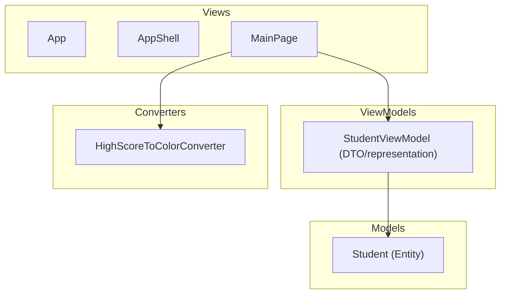

# StockRoom — a warehouse app built lab by lab

StockRoom is a .NET MAUI (C#, MVVM) mobile app for running a small warehouse.
It is also a **teaching project**: it is built one lab at a time for the
*Mobile Development (.NET MAUI)* course, and the repository records every step
of building mobile software, from a single MVVM form to an offline-first app
backed by a database.

## What we are building

A deliberately **simple** warehouse app: one warehouse, three people, three
roles, about ten products. It does four things:

- shows the **product list** with characteristics and quantity on hand;
- **sorts** the list by any characteristic;
- lets the manager **add products and characteristics**;
- **scans a barcode**, then the user chooses **In** or **Out** and enters the
  **number of units**. A barcode identifies a product (a kind of unit), so
  one scan can record many units.

Entities use UUID keys, `CreatedAt`/`UpdatedAt` and an owner (`CreatedByUserId`),
and are designed in third normal form. Until Lab 4 data lives in memory; in
Lab 4 it moves to **SQLite**, a single file that is easy to export.

Details: [`docs/domain/domain-model.md`](docs/domain/domain-model.md) (overview, roles)
and [`docs/domain/entities.md`](docs/domain/entities.md) (every entity, its fields and relations).

## Why a warehouse

The course's sample domains (a student list, a railway ERP) only show the
techniques. A small warehouse gives every lab a real job to do without
growing into a big system:

| Lab | Course topic | What it becomes in StockRoom |
|-----|--------------|------------------------------|
| 1 | MVVM, data binding, `INotifyPropertyChanged`, validation | Add-product form with validation *(done on the Student model; moves to Product)* |
| 2 | Shell navigation, `ICommand`, routes, passing parameters | Product list → details → edit characteristics and return; add characteristics; sort; In/Out page |
| 3 | App and page lifecycle, DI, saving state, theme, deep links | App state service, drafts survive backgrounding, reload on `OnAppearing`, theme switch, `stockroom://product/{barcode}`, **barcode scanner** (camera stops on `OnDisappearing`) |
| 4 | SQLite, repository pattern, CRUD, migrations, sync, encryption | Entities mapped to SQLite tables, repositories, schema migrations via `PRAGMA user_version`, database export |


## How the project is developed

**Rules:** [`AGENTS.md`](AGENTS.md) (scope, SOLID/DRY/KISS, layers, tests,
workflow). **Plan:** [`docs/plan.md`](docs/plan.md).

The lab PDFs (kept locally in `Mobile_apps_L1_Model_view/docks/`, not in git)
describe *general* techniques, not exact steps for this app. Each lab is
handled like this:

1. **Read the lab** and list what it asks for.
2. **Compare with the current app**: what already exists, what is missing.
3. **Break it down** into small tasks that fit the warehouse domain, plus any
   related work the step needs (tests, refactoring, UI).
4. **One pull request per lab.** No direct commits to `master`.
5. **Write a step document** in [`docs/steps/`](docs/steps) for each PR:
   - what the app had before;
   - what the lab asked for;
   - how we read it for the warehouse domain;
   - which decisions we made and why;
   - the PR link and a short summary of the changes.

Template: [`docs/steps/_template.md`](docs/steps/_template.md).

### Branches and PRs

- One branch per lab, stacked: `lab1` → `master`, `lab2` → `lab1`,
  `lab3` → `lab2`, `lab4` → `lab3` (the course asks for branches named `lab3`, `lab4`).
- Commit and PR titles: `[Lab N] <what changed>`.
- Every PR that changes behaviour updates or adds tests in
  `Mobile_apps_L1_Model_view.Tests`.

## Step log

| Step | Lab | Document | Status |
|------|-----|----------|--------|
| 00 | — | [Project vision and domain model](docs/steps/00-vision-and-roles.md) | in review |
| 01 | 1 | [Warehouse domain, MVVM, validation](docs/steps/01-warehouse-entities.md) | in progress |
| 02 | 2 | Shell navigation, parameters, characteristics, sorting | planned |
| 03 | 3 | Lifecycle, DI, state, theme, deep links, scanner | planned |
| 04 | 4 | SQLite, repositories, sync queue, encryption | planned |

## Decision log

Every architectural decision, newest last. Details are in the step documents.

| # | Lab | Decision | Why |
|---|-----|----------|-----|
| 1 | — | Warehouse domain, kept small (3 users, ~10 products) | Real reasons for every lab technique without building an ERP |
| 2 | — | Characteristics as rows (`Characteristics` + `ProductCharacteristics`) | Add characteristics at runtime without schema changes |
| 3 | — | One `Operations` table; quantity on hand is computed | 3NF; one source of truth for stock |
| 4 | — | UUID keys, `CreatedAt`/`UpdatedAt`, `CreatedByUserId` on every entity | Offline/sync-safe IDs; every row records who and when |
| 5 | — | Schema designed now, SQLite added in Lab 4 | Follows the course order; Lab 4 only adds storage |
| 6 | 1 | `Entity`/`OwnedEntity` base classes, UUID v7 | DRY; time-ordered IDs index well |
| 7 | 1 | Relations as IDs only, no navigation properties | Entities match tables; joins live in services |
| 8 | — | Stacked branches `lab1`…`lab4`, one PR per lab | Each lab reviewable alone; matches course branch names |
| 9 | — | Code, docs and UI in English | Project owner's choice |

## Architecture



## Repository layout

```
Mobile_apps_L1_Model_view/        MAUI app (Models, ViewModels, Views, Converters)
Mobile_apps_L1_Model_view/docks/  Lab assignments (PDF, Ukrainian)
Mobile_apps_L1_Model_view.Tests/  Unit tests (ViewModels, models, converters)
docs/domain/                      Domain model, roles, entity catalogue
docs/steps/                       One document per step / PR
```

## Build and run

Requires the .NET 10 SDK with the MAUI workload.

```bash
dotnet build Mobile_apps_L1_Model_view/Mobile_apps_L1_Model_view.csproj -f net10.0-windows10.0.19041.0
dotnet test Mobile_apps_L1_Model_view.Tests
```
