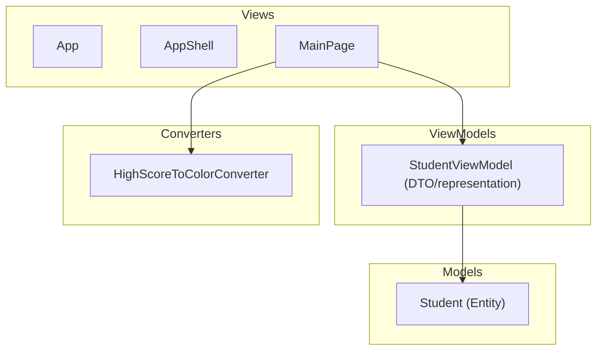

# StockRoom — a warehouse app built lab by lab

StockRoom is a .NET MAUI (C#, MVVM) mobile app for running a small warehouse.
It is also a **teaching project**: it is built one lab at a time for the
*Mobile Development (.NET MAUI)* course, and the repository records every step
of building mobile software, from a single MVVM form to an offline-first app
backed by a database.

## What we are building

A warehouse app where people can:

- see **current stock**: which products are on hand, how many, and where;
- see **stock-out history**: which products ran out, when, and for how long;
- watch **dashboards**: low-stock alerts, deliveries expected today, stock
  movement over time;
- do warehouse work: **receive deliveries, issue goods, move stock between
  locations, count stock**;
- work in a **role-based** way: a storekeeper, a supplier's driver and a
  warehouse manager each see and do different things.

The domain model and roles are described in
[`docs/domain/roles.md`](docs/domain/roles.md).

## Why a warehouse

The course's sample domains (a student list, a railway ERP) only show the
techniques. A warehouse gives every lab a real job to do:

| Lab | Course topic | What it becomes in StockRoom |
|-----|--------------|------------------------------|
| 1 | MVVM, data binding, `INotifyPropertyChanged`, validation | Product entry form with validation *(done on the Student model; moves to Product in a later step)* |
| 2 | Shell navigation, `ICommand`, routes, passing parameters | Product list → product details → edit and return the updated product |
| 3 | App and page lifecycle, DI, saving state, theme, deep links | Session and role kept in a singleton service, last screen restored, light/dark theme, `stockroom://product/{id}` deep links |
| 4 | SQLite, repository pattern, CRUD, migrations, sync, encryption | Local database of products, stock and movements; an offline sync queue for drivers on the road; encrypted credentials |

## How the project is developed

The lab PDFs in [`Mobile_apps_L1_Model_view/docks/`](Mobile_apps_L1_Model_view/docks)
describe *general* techniques, not exact steps for this app. Each lab is
handled like this:

1. **Read the lab** and list what it asks for.
2. **Compare with the current app**: what already exists, what is missing.
3. **Break it down** into small tasks that fit the warehouse domain, plus any
   related work the step needs (tests, refactoring, UI).
4. **One pull request per task.** No direct commits to `master`.
5. **Write a step document** in [`docs/steps/`](docs/steps) for each PR:
   - what the app had before;
   - what the lab asked for;
   - how we read it for the warehouse domain;
   - which decisions we made and why;
   - the PR link and a short summary of the changes.

Template: [`docs/steps/_template.md`](docs/steps/_template.md).

### Branches and PRs

- Branch names: `<type>/<step>-<short-name>`, for example `feat/02-product-details`
  or `docs/00-vision-and-roles`.
- PR title: `[Lab N] <what changed>`.
- Every PR that changes behaviour updates or adds tests in
  `Mobile_apps_L1_Model_view.Tests`.

## Step log

| Step | Lab | Document | Status |
|------|-----|----------|--------|
| 00 | — | [Project vision and role model](docs/steps/00-vision-and-roles.md) | in review |

## Current architecture (Lab 1)



## Repository layout

```
Mobile_apps_L1_Model_view/        MAUI app (Models, ViewModels, Views, Converters)
Mobile_apps_L1_Model_view/docks/  Lab assignments (PDF, Ukrainian)
Mobile_apps_L1_Model_view.Tests/  Unit tests (ViewModels, models, converters)
docs/domain/                      Domain model and roles
docs/steps/                       One document per step / PR
```

## Build and run

Requires the .NET 10 SDK with the MAUI workload.

```bash
dotnet build Mobile_apps_L1_Model_view/Mobile_apps_L1_Model_view.csproj -f net10.0-windows10.0.19041.0
dotnet test Mobile_apps_L1_Model_view.Tests
```
