# Architecture

```mermaid
graph TD
    subgraph Views
        AppShell
        LoginPage
        ProductsPage
        ProductFormPage
        ProductDetailPage
        CharacteristicsPage
        OperationPage
        SettingsPage
        SearchPage
        CameraScannerView
        PageLifecycleBehavior
        MapPage
        PinMapView
    end
    subgraph ViewModels
        LoginViewModel
        ProductListViewModel
        ProductFormViewModel
        ProductDetailViewModel
        CharacteristicsViewModel
        OperationViewModel
        SettingsViewModel
        SearchViewModel
        MapViewModel
        ProductPhotoEditor
        ConnectivityBannerViewModel
        IPageLifecycleAware
    end
    subgraph Converters
        QuantityToColorConverter
    end
    subgraph Services
        IStockService
        IProductService
        IProductValidator
        IProductCatalog
        ICharacteristicService
        ICharacteristicValidator
        ProductSorter
        ProductSearch
        ICurrentUserService
        INavigationService
        IClock
        RolePermissions
        Ean13
        IAppStateService
        IPreferencesStore
        IAppLifecycleService
        IThemeService
        IThemeApplier
        IDeepLinkHandler
        DeepLinkParser
        IStartupNavigator
        IBarcodeScanner
        IAlertService
        ISyncService
        ISyncApi
        IConnectivityMonitor
        IOfflineSimulator
        IFieldEncryptor
        ISecretStore
        IDatabaseExporter
        IFileSharer
        IPermissionService
        IPhotoService
        ILocationService
        IShakeDetector
        IShakeGesture
        IMapLauncher
        IMainThread
        IDeviceFeedback
    end
    subgraph Data
        IUserRepository
        IProductRepository
        IOperationRepository
        ICharacteristicRepository
        IProductCharacteristicRepository
        Sqlite["Sqlite*Repository (SqliteRepository base)"]
        IDatabase
        MigrationRunner
        SyncJournal
        ISyncQueue
        Migrations["Migrations/*.sql"]
    end
    subgraph Models
        Entities["User, Product, Characteristic, ProductCharacteristic, Operation"]
    end

    LoginPage --> LoginViewModel
    ProductsPage --> ProductListViewModel
    ProductsPage --> QuantityToColorConverter
    ProductFormPage --> ProductFormViewModel
    LoginViewModel --> IUserRepository
    LoginViewModel --> ICurrentUserService
    LoginViewModel --> INavigationService
    ProductListViewModel --> IProductCatalog
    ProductListViewModel --> ICharacteristicService
    ProductListViewModel --> ProductSorter
    ProductListViewModel --> ProductSearch
    ProductListViewModel --> INavigationService
    ProductDetailPage --> ProductDetailViewModel
    CharacteristicsPage --> CharacteristicsViewModel
    OperationPage --> OperationViewModel
    ProductDetailViewModel --> IProductCatalog
    ProductDetailViewModel --> ICharacteristicService
    ProductDetailViewModel --> ICharacteristicValidator
    ProductDetailViewModel --> INavigationService
    CharacteristicsViewModel --> ICharacteristicService
    CharacteristicsViewModel --> INavigationService
    OperationViewModel --> IStockService
    OperationViewModel --> INavigationService
    IProductCatalog --> IStockService
    IProductCatalog --> IProductRepository
    ICharacteristicService --> ICharacteristicValidator
    ICharacteristicService --> IProductCharacteristicRepository
    ProductFormViewModel --> IProductValidator
    ProductFormViewModel --> IProductService
    IProductService --> IProductValidator
    IProductService --> IProductRepository
    IStockService --> IOperationRepository
    IStockService --> RolePermissions
    IProductValidator --> Ean13
    IProductValidator --> IProductRepository
    Sqlite -.implements.-> IProductRepository
    Sqlite --> IDatabase
    Sqlite --> SyncJournal
    SyncJournal --> ISyncQueue
    IDatabase --> MigrationRunner
    MigrationRunner --> Migrations
    Sqlite --> IFieldEncryptor
    IFieldEncryptor --> ISecretStore
    ISyncService --> ISyncQueue
    ISyncService --> ISyncApi
    ISyncService --> IConnectivityMonitor
    ISyncService --> IOfflineSimulator
    IAppLifecycleService --> ISyncService
    SettingsViewModel --> ISyncService
    SettingsViewModel --> IDatabaseExporter
    IDatabaseExporter --> IDatabase
    IDatabaseExporter --> IFileSharer
    ProductListViewModel --> IProductService
    IProductService --> IOperationRepository
    IProductRepository --> Entities
    SettingsPage --> SettingsViewModel
    SearchPage --> SearchViewModel
    SearchPage --> CameraScannerView
    SearchPage --> PageLifecycleBehavior
    PageLifecycleBehavior -.calls.-> IPageLifecycleAware
    ProductListViewModel -.implements.-> IPageLifecycleAware
    SearchViewModel -.implements.-> IPageLifecycleAware
    CameraScannerView -- "DetectedCommand" --> SearchViewModel
    SettingsViewModel --> IThemeService
    SettingsViewModel --> IDeepLinkHandler
    SearchViewModel --> IBarcodeScanner
    SearchViewModel --> IProductCatalog
    SearchViewModel --> INavigationService
    ProductListViewModel --> IStartupNavigator
    ProductListViewModel --> IAppStateService
    ProductFormViewModel --> IAppStateService
    OperationViewModel --> IAppStateService
    ProductDetailViewModel --> IAppStateService
    ProductFormViewModel --> ProductPhotoEditor
    ProductDetailViewModel --> ProductPhotoEditor
    ProductPhotoEditor --> IPhotoService
    ProductPhotoEditor --> IDeviceFeedback
    IPhotoService --> IPermissionService
    ILocationService --> IPermissionService
    OperationViewModel --> ILocationService
    OperationViewModel --> IDeviceFeedback
    MapPage --> MapViewModel
    MapPage --> PinMapView
    MapViewModel --> IProductCatalog
    MapViewModel --> IMapLauncher
    ProductListViewModel --> IShakeGesture
    HomeViewModel --> IShakeGesture
    IShakeGesture --> IShakeDetector
    IShakeGesture --> IMainThread
    ProductListViewModel --> ConnectivityBannerViewModel
    ConnectivityBannerViewModel --> ISyncService
    App["App (window events)"] --> IAppLifecycleService
    IAppLifecycleService --> IAppStateService
    IAppLifecycleService --> IThemeService
    IAppLifecycleService --> ICurrentUserService
    IAppStateService --> IPreferencesStore
    IThemeService --> IPreferencesStore
    IThemeService --> IThemeApplier
    IStartupNavigator --> IDeepLinkHandler
    IStartupNavigator --> IAppStateService
    IDeepLinkHandler --> DeepLinkParser
    IDeepLinkHandler --> IProductCatalog
    IDeepLinkHandler --> IAlertService
    IDeepLinkHandler --> INavigationService
```



## Repository layout

```
StockRoom.Core/                   Platform-free core (net10.0): Models, Services, Data, ViewModels, AddStockRoomCore
StockRoom.Core/Data/Migrations/   Numbered SQL schema scripts (embedded resources)
Mobile_apps_L1_Model_view/        MAUI app: Views, Converters, Platforms, Maui*/Shell* implementations, MauiProgram
Mobile_apps_L1_Model_view/docks/  Lab assignments (PDF, Ukrainian)
Mobile_apps_L1_Model_view.Tests/  Unit, integration and end-to-end tests of Core (net10.0, any OS; real SQLite file, fake platform services)
Mobile_apps_L1_Model_view.AppTests/  Tests of MAUI-bound classes (Windows only)
Mobile_apps_L1_Model_view.UiTests/ Appium UI tests ([Category=UI], not run in CI)
.github/                          CI workflow and the coverage gate script
docs/domain/                      Domain model, roles, entity catalogue
docs/steps/                       One document per step / PR
```

## Logging

Serilog writes `logs/stockroom-YYYYMMDD.log` in the app data folder (daily, 7 files kept) with the fixed format
`{Timestamp:o} [{Level:u3}] {SourceContext} {Message:lj}{NewLine}{Exception}` (`LogFormat`). Code logs through
`ILogger<T>` only; rules (levels, templates, never log personal data) are in [`AGENTS.md`](../AGENTS.md) section 2a.
A Manager reads the log in the app: **Settings -> Diagnostics -> Open logs** (level filter, newest first), and can
generate test entries, an unobserved background exception and a test crash from the same section.
