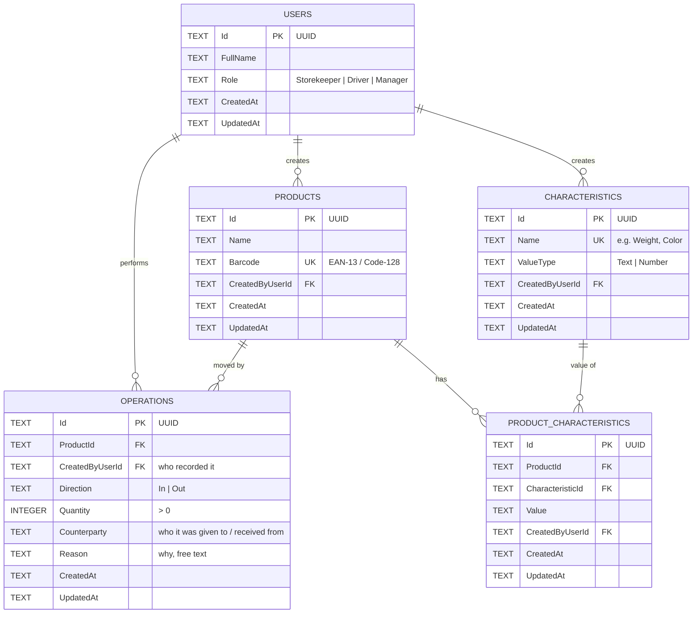
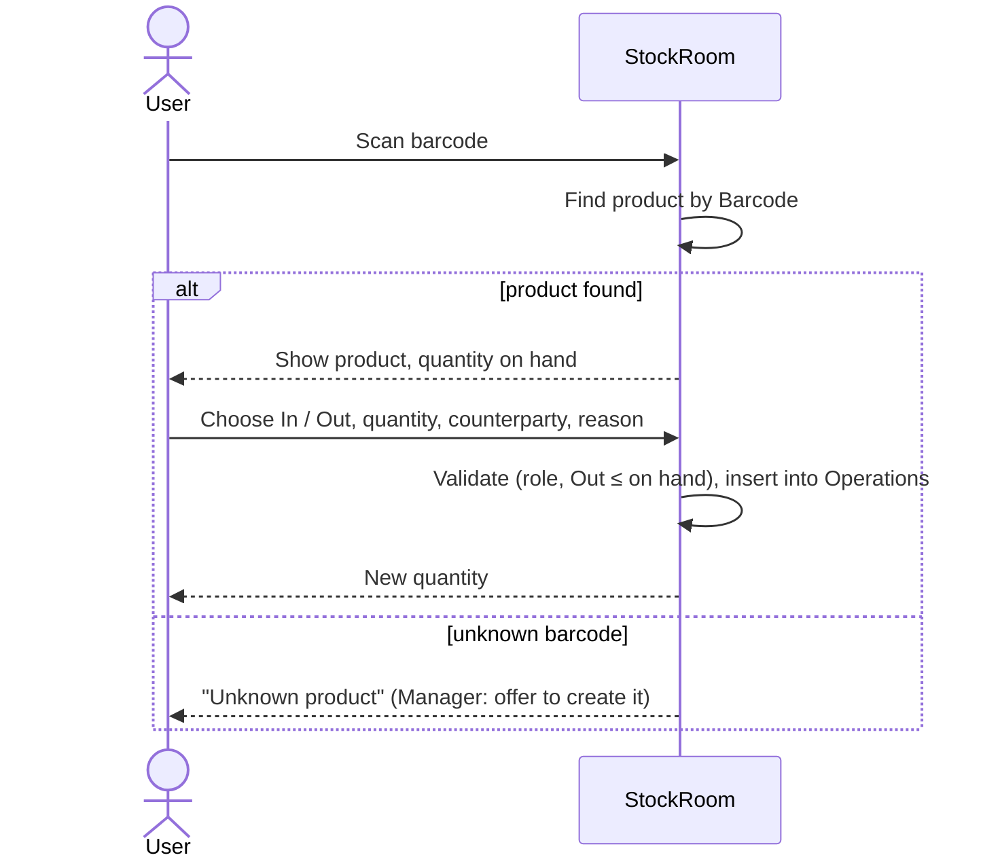

# Domain model

StockRoom is deliberately **small**: one warehouse, three people, three roles,
about ten products. The app does four things:

1. Shows the **product list** with each product's characteristics and current quantity.
2. **Sorts** the list by any characteristic.
3. Lets you **add products** and **add characteristics**.
4. **Scans a barcode** and records that goods were taken out or brought in.

No dashboards, approvals or several warehouses. Anything beyond this list is a
separate decision.

## Roles

| Role | What they do in the app |
|------|-------------------------|
| **Storekeeper** | Browses and sorts products; scans a product and records **In** or **Out** |
| **Supplier driver** | Scans the products they bring and records **In** |
| **Manager** | Everything the storekeeper does, plus **adds products and characteristics** |

| Action | Storekeeper | Driver | Manager |
|--------|:-----------:|:------:|:-------:|
| View / sort product list | ✔ | ✔ | ✔ |
| Scan → In | ✔ | ✔ | ✔ |
| Scan → Out | ✔ | — | ✔ |
| Add / edit product | — | — | ✔ |
| Add characteristic, set its value on a product | — | — | ✔ |
| View operation history | ✔ | own only | ✔ |

There is no real authentication. On start the user picks one of the three
seeded accounts.

## Database (SQLite, Lab 4)

The schema is designed now, so the C# entities match it from the start
(see [`entities.md`](entities.md)). Until Lab 4 the data is kept in memory;
in Lab 4 it moves to SQLite.

Conventions for **every** table:

- `Id` is a **UUID**, stored as `TEXT` (SQLite has no native UUID type).
- `CreatedAt` and `UpdatedAt` are UTC timestamps stored as ISO-8601 `TEXT`.
  This keeps an exported database readable in any SQLite viewer.
- **Ownership:** every table except `Users` has `CreatedByUserId` (FK to
  `Users`), so each row answers "who did this".
- The schema is in **third normal form**: every non-key column depends only on
  the whole key, and nothing that can be computed is stored.

### Tables

| Table | Purpose | Constraints |
|-------|---------|-------------|
| `Users` | The three people | `Role` ∈ {Storekeeper, Driver, Manager} |
| `Products` | What is stored: only name and barcode | `Barcode` unique |
| `Characteristics` | The list of possible characteristics (id + name) | `Name` unique |
| `ProductCharacteristics` | The value of one characteristic for one product | unique (`ProductId`, `CharacteristicId`) |
| `Operations` | Every In / Out: the only way quantity changes | `Quantity > 0`, `Direction` ∈ {In, Out} |

### What is computed, not stored

| Value | Computed as |
|-------|-------------|
| Quantity on hand | `SUM(Quantity WHERE In) − SUM(Quantity WHERE Out)` per product |
| First delivered | `MIN(CreatedAt)` of the product's `In` operations |
| Last taken out | `MAX(CreatedAt)` of the product's `Out` operations |

Storing these on `Products` would break 3NF and could drift out of sync with
`Operations`.

### Design notes

- **Characteristics are rows, not columns.** Adding "Color" means inserting a
  row in `Characteristics`, not changing the schema. That is how the app can
  add characteristics at runtime.
- **`ValueType`** is needed only for sorting: as numbers `9 < 10`, but as text
  `"10" < "9"`. Values are stored as text and parsed when `ValueType = Number`.
- **`Role` and `Direction` are text enums, not lookup tables.** Each is a fixed
  set of values with no attributes of its own, so this is still 3NF and the
  exported file stays readable.
- **Rules:** an `Out` larger than the quantity on hand is rejected; operations
  are never edited or deleted (a mistake is fixed by a new opposite operation).

## Scan flow

## Seed data

One warehouse (implicit), three users (one per role), about ten products,
three to four characteristics (e.g. *Weight, kg* — Number; *Color* — Text;
*Category* — Text), and a few operations so quantities are not zero.

## Export

The whole database is one SQLite file in the app's data folder. A **Share
database** action copies it out through the system share sheet, so it can be
opened on a PC (DB Browser for SQLite, DBeaver).
