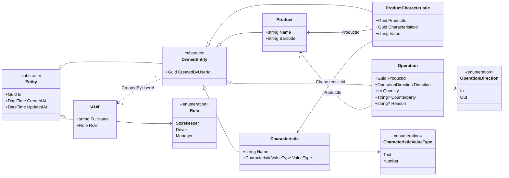

# Entities

The catalogue of StockRoom's domain entities: what each one is, its fields,
how it relates to the others, who can do what with it, and how it can grow.
The overview, roles and computed values are in [`domain-model.md`](domain-model.md).

The entities are plain C# classes in `Mobile_apps_L1_Model_view/Models`, free of
storage attributes. Since Lab 4 they are stored in SQLite tables with the same
names and columns: each repository converts an entity to a *row* class
(`Data/Rows`, text ids, enum names and ISO-8601 timestamps) and back. The
schema is the SQL in `Data/Migrations/0001_initial.sql`; see
[`docs/steps/04-sqlite.md`](../steps/04-sqlite.md).

## Diagram

## Common base

### `Entity`

Base for everything stored.

| Field | Type | Rules |
|-------|------|-------|
| `Id` | `Guid` | Assigned on creation, never changes. UUID v7 (`Guid.CreateVersion7()`), which is time-ordered, so new rows sort to the end of an index |
| `CreatedAt` | `DateTime` (UTC) | Set on creation, never changes |
| `UpdatedAt` | `DateTime` (UTC) | Equals `CreatedAt` on creation; updated on every edit |

### `OwnedEntity : Entity`

Base for everything a user creates. Answers "who did this".

| Field | Type | Rules |
|-------|------|-------|
| `CreatedByUserId` | `Guid` → `User.Id` | Required; the current user at the moment of creation |

Relations are stored as **IDs only**, with no navigation properties. This
matches the future tables one to one, keeps entities free of loading logic,
and leaves joining data to ViewModels and, later, repositories.

---

## `User`

A person who uses the app. There are three, one per role, seeded at start.

| Field | Type | Rules |
|-------|------|-------|
| `FullName` | `string` | Required, not blank |
| `Role` | `Role` | `Storekeeper`, `Driver` or `Manager` |

- **Relations:** is the `CreatedByUserId` of every `OwnedEntity`.
- **Who can do what:** nobody edits users in the app; the user only *picks*
  one on the login screen.
- **Not owned:** users are seeded, so there is no "creator" for them.
- **Scaling:** login / PIN, more users per role, several roles per user
  (a `UserRoles` link table instead of the `Role` field).

## `Product`

Something stored in the warehouse. Deliberately holds only identity; all
descriptive data lives in characteristics.

| Field | Type | Rules |
|-------|------|-------|
| `Name` | `string` | Required, not blank |
| `Barcode` | `string` | Required, unique; EAN-13 (13 digits, valid check digit) |

- **Relations:** has many `ProductCharacteristic`s (its description) and many
  `Operation`s (its movement history).
- **Computed, not stored:** quantity on hand, first delivered, last taken out
  (see [`domain-model.md`](domain-model.md#what-is-computed-not-stored)).
- **Who can do what:** the Manager creates and renames products. Everyone views
  them. Scanning looks a product up by `Barcode`.
- **Edited and deleted by the Manager.** An edit keeps the barcode unique
  (the product's own barcode does not count as a duplicate).
- **Not deleted** once it has operations, because history must stay complete:
  the `Operations → Products` foreign key has no cascade, and `ProductService`
  refuses with an explanation. Deleting a product without operations also
  removes its characteristic values. An `IsArchived` flag can be added if needed.
- **Scaling:** more barcode formats (Code-128, QR), a unit of measure, a
  minimum stock level for low-stock alerts, photos.

## `Characteristic`

A *kind* of property a product can have: "Weight", "Color", "Category".
It is a definition only; the actual values are in `ProductCharacteristic`.

| Field | Type | Rules |
|-------|------|-------|
| `Name` | `string` | Required, unique (case-insensitive) |
| `ValueType` | `CharacteristicValueType` | `Text` or `Number`; decides how values are validated and sorted |

- **Relations:** has many `ProductCharacteristic`s.
- **Who can do what:** the Manager creates characteristics. Everyone can
  **sort** the product list by one.
- **Rule:** `ValueType` cannot change once values exist, because existing
  values could become invalid.
- **Scaling:** a unit (`kg`, `cm`), more value types (`Date`, `Boolean`,
  a fixed list of options), display order.

## `ProductCharacteristic`

The value of one characteristic for one product: "Laptop → Weight → 1.4".

| Field | Type | Rules |
|-------|------|-------|
| `ProductId` | `Guid` → `Product.Id` | Required |
| `CharacteristicId` | `Guid` → `Characteristic.Id` | Required |
| `Value` | `string` | Required; if the characteristic's type is `Number`, must parse as a number (invariant culture) |

- **Uniqueness:** at most one value per (`ProductId`, `CharacteristicId`).
- **Who can do what:** the Manager sets, changes or removes a value. Everyone
  sees it in the list and details.
- **Why a separate entity:** it is a many-to-many link with its own data.
  Putting values on `Product` would need a column per characteristic and a
  schema change for every new one.
- **Scaling:** typed value columns (`NumberValue`, `DateValue`) instead of
  parsing text, if sorting large lists gets slow.

## `Operation`

One movement of goods: **In** (brought into the warehouse) or **Out** (taken
out). The **only** way quantity changes.

| Field | Type | Rules |
|-------|------|-------|
| `ProductId` | `Guid` → `Product.Id` | Required |
| `Direction` | `OperationDirection` | `In` or `Out` |
| `Quantity` | `int` | `> 0`; for `Out`, ≤ quantity on hand |
| `Counterparty` | `string?` | Who it was received from / given to. Personal data: **stored AES-encrypted** (base64), plain in the app |
| `Reason` | `string?` | Why: "delivery", "order #12", "damaged" |
| `CreatedByUserId` | inherited | Who recorded it |
| `CreatedAt` | inherited | When it happened |

- **Who can do what:** Storekeeper and Manager record `In` and `Out`; the
  Driver records `In` only. Everyone sees the history (the Driver only their own).
- **Immutable:** never edited or deleted. A mistake is fixed by a new
  operation in the opposite direction, so `UpdatedAt` always equals `CreatedAt`.
- **Scaling:** a `Location` reference (several warehouses or shelves), a link
  to a delivery document, a `Transfer` direction.

---

## Enums

| Enum | Values | Used by |
|------|--------|---------|
| `Role` | `Storekeeper`, `Driver`, `Manager` | `User.Role` |
| `CharacteristicValueType` | `Text`, `Number` | `Characteristic.ValueType` |
| `OperationDirection` | `In`, `Out` | `Operation.Direction` |

Each is a fixed set with no data of its own, so an enum (stored later as its
name, as text) is enough. A lookup table is needed only if values must be
added at runtime.

## Who changes what

| Entity | Storekeeper | Driver | Manager |
|--------|-------------|--------|---------|
| `User` | pick self | pick self | pick self |
| `Product` | view | view | create, edit, delete (no operations) |
| `Characteristic` | view, sort by | view, sort by | create |
| `ProductCharacteristic` | view | view | set, change, remove |
| `Operation` | create In/Out, view | create In, view own | create In/Out, view |

## How it scales

| Need | Change |
|------|--------|
| Several warehouses / shelves | New `Location : OwnedEntity`; `Operation.LocationId`; quantity computed per location |
| Low-stock alerts | `Product.MinQuantity` |
| Delivery documents | New `Delivery : OwnedEntity`; `Operation.DeliveryId?` |
| Edit history for products | Audit table, or `UpdatedByUserId` on `OwnedEntity` |
| Sync between devices (Lab 4) | Done for the push direction: UUID keys never clash, every write is queued in `SyncQueue`, and the server applies "last write wins" by change time. Pulling other devices' changes is future work |
