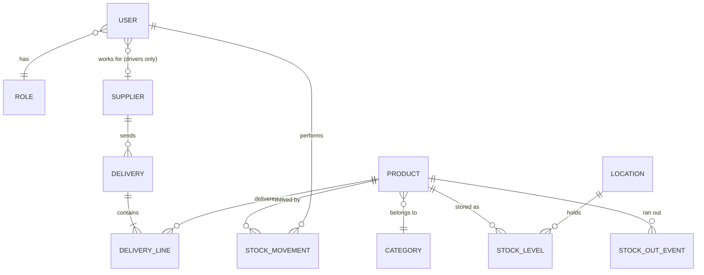
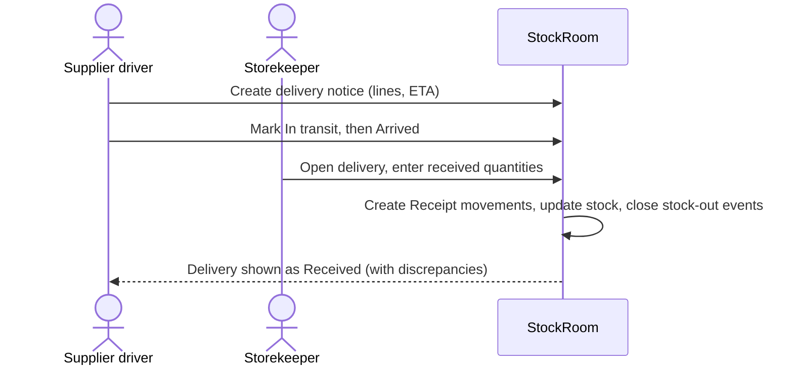
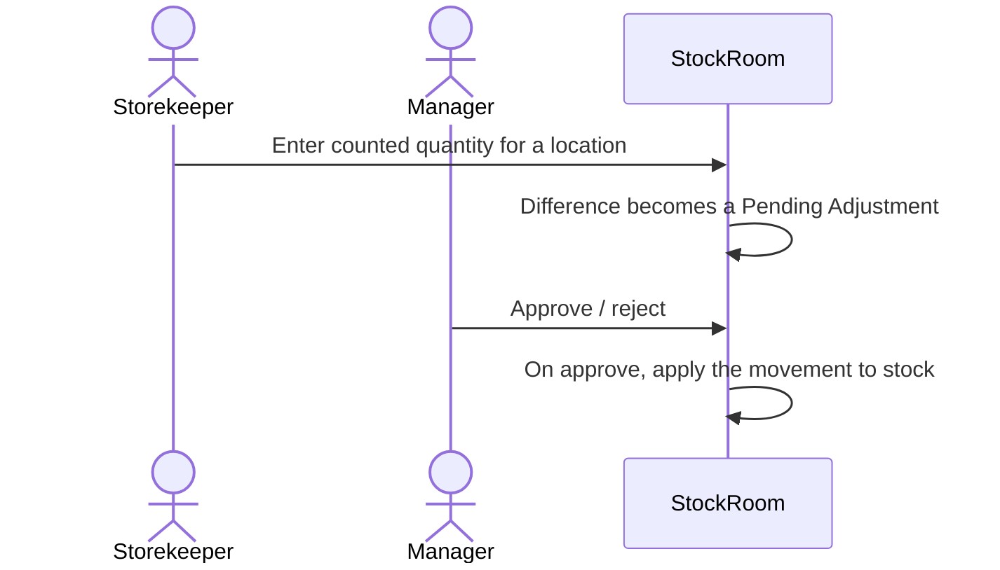

# Domain model and roles

This is the warehouse model that StockRoom's screens, ViewModels and database
are built on. It covers **one warehouse** with storage locations inside it.
Supporting several warehouses is a later step.

## Roles

| Role | Who it is | Main goal in the app |
|------|-----------|----------------------|
| **Storekeeper** | Works inside the warehouse | Keep the stock numbers true: receive, issue, move and count goods |
| **Supplier driver** | Brings goods from a supplier | Announce a delivery, bring it, get it signed off |
| **Warehouse manager** | Runs the warehouse | Watch stock levels, react to shortages, manage the catalog and the people |

A user has exactly one role. Role switching is not supported; a person who
needs two roles gets two accounts.

### Storekeeper

- Browses products and stock levels, searches by name or SKU.
- **Receives** a delivery: checks the delivery's lines against what arrived,
  enters the quantities actually received, and notes damaged or missing items.
- **Issues** goods out of the warehouse (an order, internal use).
- **Moves** stock between locations (e.g. from receiving area `A-01` to shelf `B-03`).
- **Counts** stock (stocktake) and enters the real quantity; the difference
  becomes an adjustment that the manager must approve.
- Sees low-stock and out-of-stock alerts.

### Supplier driver

- Sees only **their own supplier's deliveries**.
- Creates a **delivery notice**: which products, how many, expected arrival time.
- Marks a delivery *In transit* → *Arrived*.
- Sees the result after the storekeeper receives it (accepted quantities,
  discrepancies).
- Works offline: drivers are often out of coverage, so their changes are queued
  and synced later (Lab 4).
- Cannot see stock levels or other suppliers' data.

### Warehouse manager

- Everything the storekeeper can **see**, plus the dashboards.
- Manages the **catalog**: products, categories, minimum stock levels.
- Manages **suppliers** and **user accounts / roles**.
- **Approves or rejects** stock adjustments and write-offs.
- Reviews the **stock-out history**: what ran out, when, for how long.

## Permission matrix

`R` = read, `W` = create/edit, `A` = approve, `own` = only records of their own supplier, `—` = no access.

| Area | Storekeeper | Supplier driver | Manager |
|------|:-----------:|:---------------:|:-------:|
| Product catalog | R | R (only products on own deliveries) | R W |
| Stock levels | R | — | R |
| Locations | R | — | R W |
| Deliveries | R, receive | R W own | R |
| Stock movements (receipt / issue / transfer) | R W | — | R |
| Adjustments / write-offs | W (request) | — | R A |
| Stock-out history | R | — | R |
| Dashboards | low-stock widget only | own deliveries widget only | R (all) |
| Suppliers | R | R own | R W |
| Users and roles | — | — | R W |

## Entities

| Entity | Key fields | Notes |
|--------|-----------|-------|
| `User` | Id, FullName, Login, Role, SupplierId? | `SupplierId` is set only for drivers |
| `Role` | `Storekeeper`, `SupplierDriver`, `Manager` | An enum, not a table |
| `Product` | Id, Sku, Name, CategoryId, Unit (pcs/kg/l), MinStock | `MinStock` is the low-stock threshold |
| `Category` | Id, Name | |
| `Location` | Id, Code (`B-03`), Description | A shelf or zone inside the warehouse |
| `StockLevel` | ProductId, LocationId, Quantity | Current quantity of a product at a location |
| `Supplier` | Id, Name, Phone | |
| `Delivery` | Id, SupplierId, DriverId, ExpectedAt, Status | Status: `Planned → InTransit → Arrived → Received` (or `Rejected`) |
| `DeliveryLine` | DeliveryId, ProductId, ExpectedQty, ReceivedQty? | `ReceivedQty` is filled in by the storekeeper |
| `StockMovement` | Id, ProductId, Type, Qty, FromLocationId?, ToLocationId?, UserId, At, Status | Type: `Receipt`, `Issue`, `Transfer`, `Adjustment`, `WriteOff`. Adjustments and write-offs start as `Pending` |
| `StockOutEvent` | Id, ProductId, StartedAt, EndedAt? | Opened when a product's total stock reaches 0, closed when it is restocked |

### Rules

1. **Stock changes only through movements.** `StockLevel.Quantity` is never
   edited directly; it is the result of applied `StockMovement` records. This
   gives a full history and makes the dashboards possible.
2. Quantity can never go below zero; an `Issue` larger than the stock is rejected.
3. `Adjustment` and `WriteOff` change stock only after a manager approves them.
4. A product is **low stock** when its total quantity is `≤ MinStock`, and
   **out of stock** at `0`. Reaching `0` opens a `StockOutEvent`.
5. Receiving a delivery creates one `Receipt` movement per line, using
   `ReceivedQty`.

## Dashboards

| Widget | Who sees it | Data |
|--------|-------------|------|
| Low stock | Storekeeper, Manager | Products with total qty ≤ MinStock |
| Out of stock now | Storekeeper, Manager | Open `StockOutEvent`s |
| Stock-out history | Manager | Closed `StockOutEvent`s, how long each lasted, top products that ran out |
| Deliveries today | Storekeeper, Manager | Deliveries with `ExpectedAt` today |
| My deliveries | Supplier driver | Own deliveries and their status |
| Movements over time | Manager | Receipts vs issues per day |
| Pending approvals | Manager | `Pending` adjustments and write-offs |

## Main flows

**Delivery (driver → storekeeper)**

**Stocktake (storekeeper → manager)**

## Not in scope (for now)

- Real authentication against a server: until Lab 4 the user picks a demo
  account on a login screen.
- Several warehouses, prices and money, purchase orders, barcode scanning.
  Each can become a separate step later.
