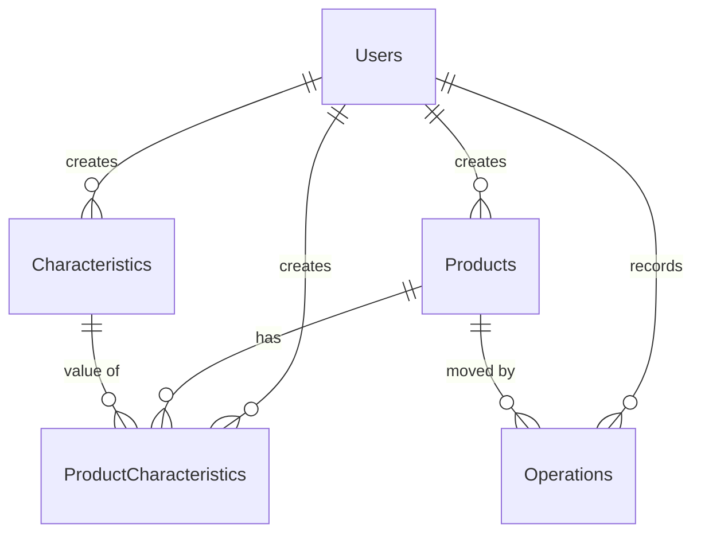

# Step 04 — SQLite, repositories, CRUD, migrations, offline sync, encryption

- **Lab:** 4 (`docks/` — "Локальна база даних та синхронізація")
- **Branch:** `lab4` (on top of `lab3`)
- **PR:** _to be added_

## 1. Before

After Lab 3 the app was complete in memory: five async repository interfaces
with in-memory implementations, a `DataSeeder` that filled them at every start
(users with fixed ids so the saved session could be restored), services on top
of the repositories, drafts and the signed-in user saved in preferences. Two
loose ends were left for this lab on purpose:

- `App.CreateWindow` and `MauiProgram` waited for async work with
  `.GetAwaiter().GetResult()` because in-memory calls complete at once;
- products could be added but not edited or deleted, and nothing survived the
  process being killed except the session and drafts.

## 2. What the lab asks for

Translated from the assignment (the lab uses `RailwayErp` / `TrainRoute`).

**In class (6 points)**

1. Design the database schema for the project's entity.
2. Implement a repository (`GetAllAsync`, `GetByIdAsync`, `SaveAsync`,
   `DeleteAsync`) and register it in DI.
3. Bind the list ViewModel to asynchronous reading: a `LoadCommand` that fills
   an `ObservableCollection`.
4. Add, edit and delete commands that call the repository and update the list.

**Independent (4 points)**

5. An offline change queue (`SyncQueue`): a CRUD change made without a network
   is queued, and a sync service sends it to a server (or a local stub API)
   when the connection returns. Conflicts: last write wins, or ask the user.
6. Encrypt one sensitive field before it is stored and decrypt it on read.

The report needs: the repository link (branch `lab4`), the DB schema, the sync
logic and conflict strategy, screenshots (list, add/edit/delete, offline mode),
answers to the control questions.

## 3. Our interpretation

The sample entity is a train route; ours is the whole warehouse schema that
Labs 1–3 already designed (`docs/domain`). Task 1 is therefore "implement that
schema exactly as SQL", with migrations. The plan adds an export action, a
"Simulate offline" switch for the demo, and a startup page.

| Lab task | In StockRoom | File |
|----------|--------------|------|
| 1. Schema | `0001_initial.sql` creates `Users`, `Products`, `Characteristics`, `ProductCharacteristics`, `Operations` (+ the `SyncQueue` outbox) with real constraints; see section 5 | `Data/Migrations/0001_initial.sql` |
| Versioning (theory 1.4) | `MigrationRunner` reads `PRAGMA user_version` and applies every newer numbered script, each in a transaction with the version bump | `Data/Migrations/*.cs` |
| Seed data | `0002_seed.sql`: three users with the fixed ids, 4 characteristics, 10 products, values, operations (the old `DataSeeder`, as SQL) | `Data/Migrations/0002_seed.sql`, `Data/SeedData.cs` |
| 2. Repository + DI | Same five interfaces, SQLite implementations over one `SqliteRepository<TEntity, TRow>` base; registered as singletons in `AddStockRoomCore`. The in-memory classes moved to the test project | `Data/Sqlite*Repository.cs`, `Data/SqliteRepository.cs`, `ServiceCollectionExtensions.cs` |
| One connection | `IDatabase` (`SqliteDatabase`): opens `stockroom.db3` on first use, `PRAGMA foreign_keys = ON`, WAL, runs the migrations once; the path comes from `IDatabasePathProvider` | `Data/IDatabase.cs`, `Data/SqliteDatabase.cs`, `Services/MauiDatabasePathProvider.cs` |
| 3. `LoadCommand` | `ProductListViewModel.LoadCommand` awaits `IProductCatalog` (which reads the repositories) and fills the `ObservableCollection`; `EnsureLoaded` runs it from `OnAppearing`. Startup no longer blocks: `App` shows `StartupPage`, awaits `RestoreAsync` (which opens the database) and then swaps in the shell | `ViewModels/ProductListViewModel.cs`, `App.xaml.cs`, `Views/StartupPage.xaml` |
| 4. Add / edit / delete | Add existed. **Edit**: the form reopens with the product (`ProductFormViewModel` in edit mode); same validation, and the barcode may stay unchanged. **Delete**: a row button asks for confirmation; refused for products with operations. Both Manager only, both update the list row from the result without a reload | `ViewModels/ProductFormViewModel.cs`, `ProductListViewModel.cs`, `Services/ProductService.cs`, `Views/ProductsPage.xaml` |
| 5. Sync queue | Every repository write also inserts a `SyncQueue` row, in the same transaction (`SyncJournal`, called from the one base class). `SyncService` pushes the queue through `ISyncApi` to a stub server when `IConnectivityMonitor` says there is internet | `Data/SyncJournal.cs`, `Data/SqliteSyncQueue.cs`, `Services/SyncService.cs`, `Services/StubSyncApi.cs` |
| Sync UI | Settings: network state, pending count, **Sync now**, **Simulate offline** switch, last result | `ViewModels/SettingsViewModel.cs`, `Views/SettingsPage.xaml` |
| 6. Encryption | `Operation.Counterparty` is encrypted (AES-256-CBC + HMAC-SHA256, random IV) by `IFieldEncryptor` inside `SqliteOperationRepository`; the key lives in `SecureStorage` behind `ISecretStore` | `Services/AesFieldEncryptor.cs`, `Data/SqliteOperationRepository.cs`, `Services/MauiSecretStore.cs` |
| (plan) Export | Settings → **Share database**: checkpoint the WAL, copy the file, open the share sheet (`Share.RequestAsync` behind `IFileSharer`) | `Services/DatabaseExporter.cs`, `Data/SqliteDatabase.cs`, `Services/MauiFileSharer.cs` |
| (plan) Tests against a real file | The end-to-end tests and the new data/sync/encryption tests build the real container with a temporary SQLite file (`TempDatabasePath`) | `Mobile_apps_L1_Model_view.Tests/` |

## 4. Decisions

| # | Decision | Alternatives considered | Why |
|---|----------|-------------------------|-----|
| 1 | `sqlite-net-pcl` 1.9.172 + `SQLitePCLRaw.bundle_green` | EF Core + `Microsoft.EntityFrameworkCore.Sqlite` | The lab prescribes sqlite-net; it is small and shows the SQL. EF Core would bring its own migrations and change tracking (answer to question 8) |
| 2 | Schema is created by **raw SQL migrations**, not `CreateTableAsync<T>()` | Attributes + `CreateTable` | `CreateTable` cannot express `CHECK`, `UNIQUE (a, b)`, `COLLATE NOCASE` or foreign keys with `REFERENCES`. The docs promise those constraints, so the SQL is the source of truth |
| 3 | Migrations are numbered `.sql` files, **embedded resources** (`Migrations/0001_initial.sql`), run by `MigrationRunner` | Code-first C# migrations; one big "create" method | Readable SQL, reviewable diff per version, nothing to copy next to the app. `SqlScriptSplitter` splits statements (it understands string literals and `--` comments, no triggers) |
| 4 | Seed data is migration `0002_seed.sql`, not code | `DataSeeder` through the repositories | It runs exactly once (the version is the idempotency guard), keeps the fixed ids, works without any service, and — importantly — does not write 100 `SyncQueue` rows: seed data ships with the app, it is not a user change |
| 5 | **Rows** (`ProductRow`, `OperationRow`, …) are the storage shape; repositories convert entity ↔ row. All ids, enums and timestamps are `TEXT` there | `[PrimaryKey]`/`[Table]` attributes on the entities; sqlite-net storing `DateTime` as ticks | Entities stay free of storage attributes (Models know nothing about SQLite). The text formats are exact: UUID `D`, enum names, timestamps `yyyy-MM-ddTHH:mm:ss.fffffffZ` (fixed width, so text order = time order), all readable in any SQLite viewer. Cost: one small mapping method pair per repository |
| 6 | `SqliteRepository<TEntity, TRow>` base: queries, insert/update/delete **and the queue write** in one place | A decorator per repository interface | DRY: one transaction helper writes the change and its `SyncQueue` row atomically. A decorator would copy every method and could not share the transaction |
| 7 | `IDatabase` opens, configures and migrates lazily on the first `GetConnectionAsync()` | Explicit `InitializeAsync()` at startup that every caller must remember | A repository cannot be used before the schema exists. Startup needs no sync-over-async: `AppLifecycleService.RestoreAsync` is the first caller and is awaited |
| 8 | `App.CreateWindow` shows `StartupPage` and replaces it with the shell after `await RestoreAsync()`; a failure shows the reason on that page | Keep `.GetAwaiter().GetResult()` | Blocking the UI thread on a database open (migration on first run) can freeze or deadlock on mobile. The page costs 20 lines |
| 9 | WAL journal mode | Default rollback journal | Readers do not block the writer, so a background sync can read the queue while the user saves. Export checkpoints first so one file is complete |
| 10 | Delete only without operations. UI: the row's Delete button is disabled (`ProductSummary.CanDelete`) and a note under the list explains why; the service and the foreign key enforce it too | Soft delete (`IsArchived`); cascading delete of operations | Operations are immutable history and the `Operations → Products` foreign key has no cascade, so deleting a product with history would either lose records or be impossible. Archiving is the documented future option |
| 11 | Deleting a product removes its `ProductCharacteristics` rows in the same transaction, each with its own queue entry | `ON DELETE CASCADE` | With a cascade the server would never hear that the values are gone |
| 12 | `SyncQueue` is infrastructure: it stores a JSON **snapshot** of the written row | Normalised change tables per entity | See "3NF and the queue" below |
| 13 | The queue stores the row as saved, so `Counterparty` is already encrypted in `PayloadJson` | Plain payload | Personal data must not leak through the outbox or to the server in clear text |
| 14 | Sync triggers: connectivity change, "Simulate offline" switched, app `Resumed` (via `IAppLifecycleService`), app start, **Sync now**. No background service | WorkManager / iOS background tasks (decision 30 left this open) | A warehouse app is used in the foreground; changes are small. Android WorkManager would sync while the app is closed, but adds a platform project, notifications and a different DI scope. Listed under next steps |
| 15 | `IConnectivityMonitor` (platform) + `IOfflineSimulator` (demo switch); `SyncService.IsOnline = HasInternet && !IsOffline` | Only airplane mode | Airplane mode needs a device; Windows has none. The switch behaves identically everywhere and makes a good screenshot |
| 16 | `ISyncApi` with a local `StubSyncApi` (in memory, a `Fail` flag) | A real REST backend; a JSON file | The lab allows a stub. The interface is what a `HttpClient` implementation would fill in. In-memory means the "server" resets when the app restarts, which is fine for the demo (the queue itself persists) |
| 17 | Conflict strategy: **last write wins by change time** (details below) | Ask the user; field-level merge | Simplest rule that is deterministic and idempotent; one warehouse, three users, rare conflicts |
| 18 | AES-256-CBC + HMAC-SHA256 (encrypt-then-MAC), random 16-byte IV per value, 64-byte key in `SecureStorage` | AES-GCM; SQLCipher | CBC+HMAC works on every target (GCM support varies on mobile runtimes) and gives integrity. SQLCipher would encrypt the whole file, but then the export is unreadable, which contradicts the export feature |
| 19 | Decryption failure shows `(encrypted - cannot be read)` in place of the counterparty and logs a warning; encryption failure refuses to record the operation with a message | Throw into the list | One bad value must not break the history page; and unprotected personal data is never written as a fallback |
| 20 | The test project owns the in-memory repositories (`Tests/Fakes/InMemory`) | Keep them in the app | They are no longer used by the app; as fast test doubles they still serve ViewModel/service unit tests. The real container is tested against SQLite |

## 5. Database schema

Source of truth: [`Data/Migrations/0001_initial.sql`](../../Mobile_apps_L1_Model_view/Data/Migrations/0001_initial.sql).
Conventions: ids are UUID text (`0196a000-0000-7000-8000-000000000001`), enums are
their names, timestamps are ISO-8601 UTC text. `PRAGMA user_version` = 2.



**Users**

| Column | Type | Constraints |
|--------|------|-------------|
| `Id` | TEXT | PRIMARY KEY |
| `FullName` | TEXT | NOT NULL, not blank |
| `Role` | TEXT | NOT NULL, CHECK in (`Storekeeper`, `Driver`, `Manager`) |
| `CreatedAt`, `UpdatedAt` | TEXT | NOT NULL |

**Products**

| Column | Type | Constraints |
|--------|------|-------------|
| `Id` | TEXT | PRIMARY KEY |
| `Name` | TEXT | NOT NULL, not blank |
| `Barcode` | TEXT | NOT NULL, **UNIQUE** |
| `CreatedByUserId` | TEXT | NOT NULL, FK → `Users(Id)` |
| `CreatedAt`, `UpdatedAt` | TEXT | NOT NULL |

**Characteristics**

| Column | Type | Constraints |
|--------|------|-------------|
| `Id` | TEXT | PRIMARY KEY |
| `Name` | TEXT | NOT NULL, **UNIQUE COLLATE NOCASE** (case-insensitive), not blank |
| `ValueType` | TEXT | NOT NULL, CHECK in (`Text`, `Number`) |
| `CreatedByUserId` | TEXT | NOT NULL, FK → `Users(Id)` |
| `CreatedAt`, `UpdatedAt` | TEXT | NOT NULL |

**ProductCharacteristics**

| Column | Type | Constraints |
|--------|------|-------------|
| `Id` | TEXT | PRIMARY KEY |
| `ProductId` | TEXT | NOT NULL, FK → `Products(Id)` |
| `CharacteristicId` | TEXT | NOT NULL, FK → `Characteristics(Id)`; index `IX_ProductCharacteristics_CharacteristicId` |
| `Value` | TEXT | NOT NULL |
| `CreatedByUserId` | TEXT | NOT NULL, FK → `Users(Id)` |
| `CreatedAt`, `UpdatedAt` | TEXT | NOT NULL |
| | | **UNIQUE (`ProductId`, `CharacteristicId`)** |

**Operations** (never updated or deleted)

| Column | Type | Constraints |
|--------|------|-------------|
| `Id` | TEXT | PRIMARY KEY |
| `ProductId` | TEXT | NOT NULL, FK → `Products(Id)` (no cascade); index `IX_Operations_ProductId` |
| `Direction` | TEXT | NOT NULL, CHECK in (`In`, `Out`) |
| `Quantity` | INTEGER | NOT NULL, **CHECK (`Quantity` > 0)** |
| `Counterparty` | TEXT | NULL; **AES-encrypted base64** when present |
| `Reason` | TEXT | NULL |
| `CreatedByUserId` | TEXT | NOT NULL, FK → `Users(Id)` |
| `CreatedAt`, `UpdatedAt` | TEXT | NOT NULL |

Quantity on hand is **not** a column: it is `SUM(In) − SUM(Out)` per product,
computed by `StockService`.

**SyncQueue** (infrastructure, see below)

| Column | Type | Constraints |
|--------|------|-------------|
| `Id` | TEXT | PRIMARY KEY (UUID v7, so ids sort by creation) |
| `EntityType` | TEXT | NOT NULL; the table name, e.g. `Products` |
| `EntityId` | TEXT | NOT NULL; the changed row's id |
| `Operation` | TEXT | NOT NULL, CHECK in (`Insert`, `Update`, `Delete`) |
| `PayloadJson` | TEXT | NOT NULL; the saved row as JSON (for `Delete`, the removed row) |
| `CreatedAt` | TEXT | NOT NULL; **when the change was made** — the conflict clock |
| `UpdatedAt` | TEXT | NOT NULL; equals `CreatedAt` until a push attempt fails, then the attempt time |

Index `IX_SyncQueue_CreatedAt`. The queue is read in insertion order (`rowid`).

### 3NF and the queue

The five domain tables are in third normal form exactly as designed in Lab 1:
every non-key column depends on the key, the whole key and nothing but the key;
the only repeated value, a characteristic's meaning, lives once in
`Characteristics`; quantity is computed, not stored. `SyncQueue` is **not**
part of the domain model: it is an outbox (a transport buffer). Its
`PayloadJson` deliberately duplicates the data of the row it describes — it
must be a snapshot of the change at that moment, which can differ from the
row's later state, and for a delete the row no longer exists. Normalising it
into per-entity change tables would defeat its purpose. Nothing in the app
reads the domain from the queue; it is only ever drained.

## 6. Migration mechanism

1. Scripts live in `Data/Migrations/NNNN_name.sql` and are compiled in as
   embedded resources named `Migrations/NNNN_name.sql` (`csproj`).
2. `EmbeddedMigrationSource` lists them, orders them by the number and rejects
   duplicates.
3. When `SqliteDatabase` opens the file it calls
   `MigrationRunner.MigrateAsync(connection)`: read `PRAGMA user_version`
   (0 for a new file); for every script with a higher number, in order, run
   inside one transaction: all statements, then `PRAGMA user_version = N`.
   If a statement fails the transaction rolls back, the version stays, and the
   app shows the error on the startup page.
4. A database whose version is **higher** than the newest script (a newer app
   wrote it) is refused with a clear message instead of being damaged.
5. To change the schema later: add `0003_*.sql` (for example
   `ALTER TABLE Products ADD COLUMN MinQuantity INTEGER NOT NULL DEFAULT 0`).
   Never edit a script that has shipped. Migrations only go forward.

## 7. Synchronisation and conflict strategy

```mermaid
sequenceDiagram
    participant VM as ViewModel / service
    participant R as Repository
    participant DB as SQLite (data + SyncQueue)
    participant S as SyncService
    participant API as ISyncApi (stub server)
    VM->>R: AddAsync / UpdateAsync / DeleteAsync
    R->>DB: BEGIN; write row; INSERT SyncQueue; COMMIT
    Note over S: network changes, app resumes,<br/>app starts, "Sync now"
    S->>S: online? (internet and not simulating offline)
    loop oldest first
        S->>API: PushAsync(item)
        alt accepted (Applied or Stale)
            S->>DB: DELETE the queue row
        else failure
            S->>DB: UPDATE UpdatedAt (attempt), stop; the rest stays queued
        end
    end
```

- **Offline first.** Nothing the user does depends on the network. Every
  write is committed locally with its queue row, atomically; the app works
  identically with or without a connection.
- **Triggers.** `IConnectivityMonitor.Changed`, the Simulate-offline switch,
  `Window.Resumed`, app start (`RestoreAsync` calls `Start()`), and the
  manual **Sync now** button. A run is skipped when another is already running
  (`Busy`). Triggers never throw.
- **Order and retry.** Items are pushed in the order they were made. A failed
  push stops the run and leaves the item and everything after it queued;
  the next trigger retries. Pushing is at-least-once: pushing the same item
  twice is harmless because the server ignores a change that is not newer
  than what it has.
- **Result** (`SyncResult`): `Synced` / `Offline` / `Failed` / `Busy`, with the
  number pushed and left. Settings shows it and the pending count.
- **Conflict strategy: last write wins, by change time.** The stub server
  remembers, for each (`EntityType`, `EntityId`), the latest accepted change
  and its time (`SyncQueueItem.CreatedAt`, which is the row's `UpdatedAt` for
  insert/update and the delete moment for delete). An incoming change **older**
  than the stored one is answered `Stale` and ignored (the queue row is still
  removed: nothing more can be done with it); otherwise it replaces the stored
  one. A delete is kept as a tombstone, so a late older update cannot bring
  the entity back. Ids are UUIDs, so two devices never create clashing ids.
  Conflicts are rare here (one warehouse, `Operations` are never edited), and
  the rule is deterministic and needs no UI. Its known weakness — a later write
  can overwrite a more important earlier one, and device clocks must be
  roughly right — is accepted; the alternatives are listed in answer 11.
- **Stub server.** `StubSyncApi` keeps its records in memory (they vanish when
  the app restarts) and has a `Fail` property to simulate an outage; unit tests
  use it for the conflict rules. A real server would implement `ISyncApi`
  with `HttpClient` calls.
- **Not synced:** seed data (shipped identically with every install) and the
  pulling of other devices' changes. This lab implements the **push** half,
  which is what the assignment describes.

## 8. Encryption

- **What:** `Operation.Counterparty`, the name of the supplier/customer, is the
  only personal-data field. Everything else is plain so an exported database
  stays readable.
- **How:** `AesFieldEncryptor` (`IFieldEncryptor`). 64 random bytes are
  generated once; the first 32 are the AES-256 key, the last 32 the HMAC key.
  Each value gets a fresh random 16-byte IV, is encrypted with AES-CBC (PKCS7),
  and `version | IV | ciphertext` is authenticated with HMAC-SHA256
  (encrypt-then-MAC). Stored as base64 text: `version(1) | IV(16) | data | MAC(32)`.
  The same name encrypted twice gives different text.
- **Where the key is:** `ISecretStore` → MAUI `SecureStorage` (Android
  Keystore, iOS Keychain, Windows data protection). It is never in the
  database, in preferences, or in the export, so an exported file cannot be
  decrypted without the device.
- **Where it happens:** inside `SqliteOperationRepository`, on the way into and
  out of the row. Services and ViewModels see plain text. The `SyncQueue`
  payload is taken from the row, so it holds the encrypted value.
- **Wrong or missing key:** `Decrypt` never creates a key. A missing key, a
  different key, tampered text and unavailable secure storage all raise
  `EncryptionException` with a readable message. The repository turns it into
  the placeholder `(encrypted - cannot be read)` for that one value and
  logs a warning, so the history page still opens. Recording an operation when
  encryption is impossible fails with "The operation was not saved. …" instead
  of storing the name in clear text. (This can really happen: restoring an
  Android backup to a new device brings the database but not the Keystore key.)
- **Known limitation:** the operation form's *draft* (Lab 3) keeps the typed
  counterparty in `Preferences` until the operation is saved or cancelled. It
  is unencrypted and short-lived; moving drafts to `ISecretStore` is a
  possible follow-up.

## 9. Changes in the PR

- **Packages:** `sqlite-net-pcl` 1.9.172, `SQLitePCLRaw.bundle_green` 2.1.11,
  patched natives `SQLitePCLRaw.lib.e_sqlite3` / `.android` 2.1.14 (the 2.1.11
  natives carry a known vulnerability).
- **Data:** `IDatabase`, `SqliteDatabase`, `IDatabasePathProvider`,
  `Migrations/` (`MigrationRunner`, `IMigrationSource`, `EmbeddedMigrationSource`,
  `SqlScriptSplitter`, `0001_initial.sql`, `0002_seed.sql`), `Rows/`,
  `RowFormat`, `RowTables`, `SqliteRepository<,>` and five `Sqlite*Repository`,
  `SyncJournal`, `ISyncQueue`/`SqliteSyncQueue`, `SeedData`. New repository
  methods: `IProductRepository.UpdateAsync/DeleteAsync`,
  `IOperationRepository.AnyForProductAsync`. Removed: `DataSeeder`,
  `IDataSeeder`, the in-memory repositories (moved to the tests).
- **Models:** `SyncQueueItem`, `SyncOperation`.
- **Services:** `ProductService` gains `UpdateAsync`/`DeleteAsync`;
  `IProductValidator.ValidateBarcodeAsync(barcode, excludeProductId)`;
  `ProductSummary.HasOperations/CanDelete`; `IAlertService.ConfirmAsync`;
  encryption (`IFieldEncryptor`, `AesFieldEncryptor`, `EncryptionException`,
  `ISecretStore`, `MauiSecretStore`); sync (`ISyncService`, `SyncService`,
  `SyncResult`, `SyncStatus`, `ISyncApi`, `StubSyncApi`, `StubServerRecord`,
  `SyncPushOutcome`, `SyncApiException`, `IConnectivityMonitor`,
  `MauiConnectivityMonitor`, `IOfflineSimulator`, `OfflineSimulator`);
  export (`IDatabaseExporter`, `DatabaseExporter`, `IFileSharer`,
  `MauiFileSharer`, `MauiDatabasePathProvider`); `AppLifecycleService` starts
  and triggers sync; `StockService` reports encryption failures.
- **ViewModels / Views:** edit mode in `ProductFormViewModel`, Edit/Delete
  commands and status in `ProductListViewModel` (+ row buttons and a note in
  `ProductsPage`), sync and export in `SettingsViewModel`/`SettingsPage`,
  `StartupStatus`/`StartupPage`, a `Compact` button style.
- **Tests:** the existing suite adapted where behaviour changed on purpose
  (the container uses SQLite; page `OnAppearing` loads really are async, so two
  tests wait for the collection; constructors that gained parameters). New:
  schema and constraints in a real file, seed, queue transactions, sync service,
  stub server conflict rules, encryption, edit/delete in service and
  ViewModels, Settings.

## 10. Manual test (Windows or Android)

1. **Start.** Launch the app: the startup page flashes, then the login page.
   `stockroom.db3` is in the app data folder (Windows, unpackaged:
   `%LOCALAPPDATA%\User Name\com.companyname.mobile_apps_l1_model_view\Data`).
2. **List (screenshot).** Sign in as *Olena Kovalenko (Manager)*: ten products
   with quantities, loaded from SQLite.
3. **Add.** *Add product* → name + `4006381333931` → Save: the row appears.
4. **Edit.** *Edit* on that row → rename, keep the barcode → Save: the row
   shows the new name. Enter another product's barcode: "A product with this
   barcode already exists."
5. **Delete.** *Delete* on the new product → confirm: it disappears. *Delete*
   is greyed out for *Cordless Drill 18V* (it has operations); the note under
   the list says why.
6. **Offline (screenshot).** Settings → turn **Simulate offline** on (on
   Android airplane mode does the same). *Network: Offline*. Go back, add a
   product and edit another, record an *In* with a counterparty. Settings:
   *Waiting to be sent: N*; **Sync now** answers "Offline: N changes wait…".
7. **Back online (screenshot).** Turn the switch off: the queue is sent by
   itself ("Synced: N sent, 0 waiting"); *Waiting to be sent: 0*. (The same
   happens when the connection returns or the app resumes.)
8. **Encryption.** Share the database (step 9) and open it with DB Browser for
   SQLite: `Operations.Counterparty` of the new row is base64, the names in
   `Products` are readable.
9. **Share database.** Settings → **Share database**: the share sheet offers
   `stockroom-export.db3`.

## 11. Control questions (answers)

**7. What are the advantages of the repository pattern over using `SQLiteAsyncConnection` directly from a ViewModel?**
The ViewModel depends on an interface (`IProductRepository`) and knows nothing
about SQL, tables, connections or sqlite-net, so (1) it can be tested with a fake
repository, no database and no UI needed; (2) the storage can be replaced
(in-memory → SQLite in this very lab; SQLite → REST) without touching a
ViewModel; (3) data-access rules — mapping, ordering, encryption of a field,
writing the sync-queue entry in the same transaction — live in one place instead
of being copied into every ViewModel (DRY, single responsibility); (4) query
code stays out of the UI layer, which keeps the layers loosely coupled. In
StockRoom the encryption and the `SyncQueue` write would otherwise be forgotten
in some ViewModel.

**8. How do sqlite-net-pcl and Entity Framework Core differ as approaches to SQLite in MAUI?**
sqlite-net-pcl is a micro-ORM: small, with attribute-based mapping, simple
async CRUD and raw SQL, one connection, and no migrations, change tracking or
LINQ-to-SQL beyond simple queries; you create tables yourself or with
`CreateTable`. It is light, fast to start and trimming-friendly, which suits
mobile. EF Core is a full ORM: a `DbContext` with change tracking, rich LINQ
translated to SQL, relationships and navigation properties, a built-in
migrations tool, and conventions; the price is a larger dependency, more
startup cost and memory, and more complexity. For a small offline app with a
handful of tables and hand-written constraints sqlite-net is enough (and it is
what the lab uses); EF Core pays off for large relational models.

**9. Why is database schema versioning needed and how is it implemented?**
The app on a user's phone outlives any single version: a new release may need a
new column or table, but the user's file already exists with data in it, and
the app cannot just recreate it. A stored schema version lets the app know
which changes are missing and apply only those, in order, once, without losing
data — and refuse a database from a newer app. Here the version is SQLite's
`PRAGMA user_version`, a number in the file header. Numbered SQL scripts
(`0001_initial.sql`, `0002_seed.sql`) are embedded in the app;
`MigrationRunner` reads the version at start and runs every script above it,
each in a transaction together with `PRAGMA user_version = N`, so a failed
migration rolls back completely. Alternatives: a metadata table with the
version, or EF Core migrations.

**10. What is the offline-first approach and how is it different from ordinary network work?**
In the ordinary (online-first) approach the screen asks the server and shows the
answer; without a connection the app shows an error or nothing. In offline-first
the local database is the source the UI reads and writes: every change is
saved locally at once and also put in a queue (`SyncQueue`), and the app is
fully usable without a network. When the connection appears a sync service
sends the queue to the server and removes what was accepted. The user never
waits for the network, never loses a change because the network dropped, and
conflicts must be handled explicitly because two devices may have changed the
same record. StockRoom does exactly this: repository writes commit the data and
the queue row together, `SyncService` pushes when `IConnectivityMonitor` reports
internet.

**11. Which conflict-resolution strategies for synchronisation do you know?**
*Last write wins* — the change with the newer timestamp replaces the other;
simple and deterministic but can silently lose an edit and depends on clocks
(used here, by `UpdatedAt`/change time). *First write wins* / server wins — the
server's version is kept and the late client change is rejected. *Client wins*.
*Ask the user* (manual resolution) — show both versions and let the user choose.
*Field-level merge* — merge changes to different fields (three-way merge with
the common ancestor). *Version numbers / ETags (optimistic concurrency)* —
reject a write based on an outdated version and make the client re-read.
*CRDTs and operation logs* — data structures or append-only events that merge
without conflicts; for example `Operations` here are never edited, only added,
so they cannot conflict at all.

**12. Which ways of encrypting local data are applicable in .NET MAUI apps?**
(1) Encrypt the whole database file with **SQLCipher** (`sqlite-net-sqlcipher`
or `SQLitePCLRaw.bundle_e_sqlcipher`) — transparent to the code, but the file is
unreadable without the key. (2) Encrypt **individual sensitive fields** in code
with AES (`System.Security.Cryptography`: AES-GCM or AES-CBC + HMAC) before
saving and decrypt after reading — used here for `Counterparty`; the rest of
the file stays readable. (3) Store **secrets and small values** (keys, tokens) in
`SecureStorage`, which uses the Android Keystore, iOS Keychain and Windows data
protection — and keep the encryption key there, never in code or in the
database. (4) Use platform file encryption (iOS data protection classes,
Android file-based encryption, Windows BitLocker) and exclude the data from
backups where needed. (5) Hash — not encrypt — what must only be compared
(passwords, with a salt and a slow hash such as PBKDF2/Argon2). The key must
live apart from the data; encrypting with a key stored next to the data adds
no security.

## 12. Open questions / next steps

- A real REST backend for `ISyncApi` and the **pull** half (fetching other
  devices' changes) with a conflict UI if "last write wins" proves too blunt.
- Android WorkManager (and iOS background tasks) to sync while the app is
  closed — decision 14.
- Encrypt the operation draft; consider SQLCipher if a stricter policy appears.
- `IsArchived` for products with history instead of "cannot delete".
- Lab 5+ may add a `UpdatedByUserId` / audit table (see `docs/domain/entities.md`).
