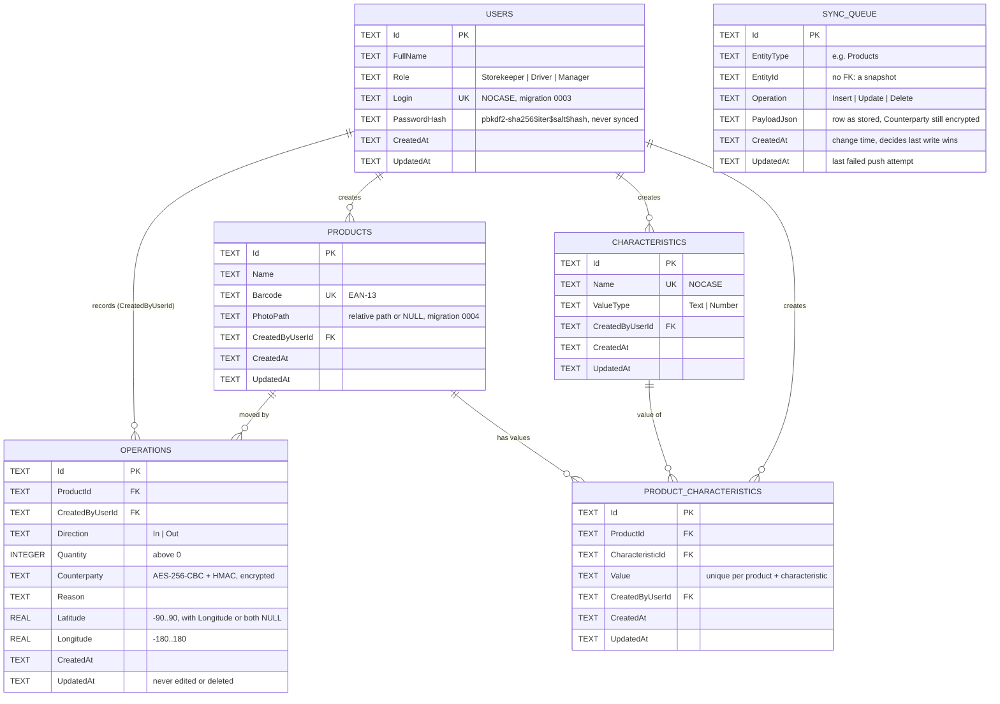
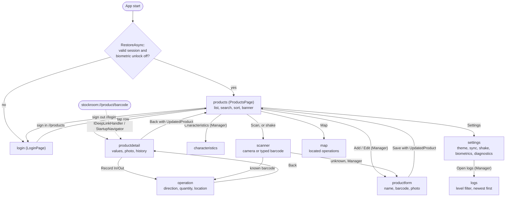
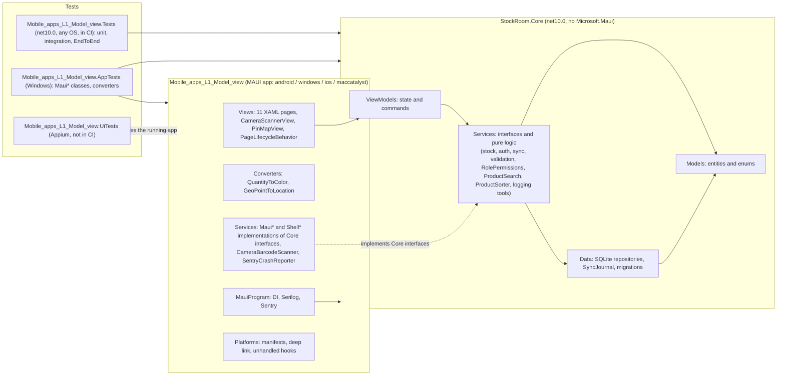

# Step 09 — Final module: search, design material, release

- **Lab:** 9 (`docks/` lab 9 PDF: a complete module that joins Labs 1-8, defended with a demo and 8 control questions)
- **Branch:** `lab9` (on top of `lab8`), tag `v1.0` after the merge (created by the owner, see `docs/RELEASE.md`)
- **PR:** _to be added_

## 1. Before

Labs 1-8 were done: MVVM list / detail / form, Shell routes, lifecycle and drafts, SQLite with a sync queue and an encrypted field, Serilog and a log viewer, login with roles and tokens, device features, the `StockRoom.Core` library, 1185 + 42 tests and a CI workflow. Two things were missing: the product list could be **sorted but not searched or filtered** (lab section 2.1 item 3), and nothing in the repository described the module as one product (no ER diagram, screen map, access matrix, DI table, demo script).

## 2. What the lab asks for

The lab's example is a railway ERP; the student builds **one module for their variant** and defends it. Our module is variant 8, **spare-parts warehouse** (Part, Receipt, Issue; storekeeper / administrator; camera and accelerometer), which is StockRoom itself (Product, Operation In / Out; Storekeeper, Driver, Manager; camera, shake, plus scanner, location, map).

1. Every row of the requirement table (lab 1.2) is applied to the module's own entities.
2. Class work: ER diagram, screens and routes, **role x screen x action matrix**, solution structure with DI; data layer; list with **search / filter** -> detail -> form with validation; login and roles checked in the UI **and** in the commands.
3. Own work: hardware with permissions and denial handling, theme, deep link, Serilog, global handler and log viewer; at least 12 unit and 2 integration tests, CI, README, a 5-7 minute demo and answers to 8 questions.
4. Report: repository link (branch `lab9`, tag `v1.0`), title page, module description, access matrix, architecture and ER diagrams, requirement table with classes, screenshots per role on Windows and Android (offline, hardware), test results and coverage, a green pipeline screenshot, an installable `.apk` or artifact link, a video up to 5 minutes, answers.

## 3. Our interpretation

The lab is the basis, not the spec: nothing from the railway example is added. What this step does:

| Lab task | In StockRoom | Status |
|----------|--------------|--------|
| Gap check of lab 1.2 against the code | section 3.1 below | done: one feature gap (search), two build problems found by a Release build, one wrong sentence in the domain doc |
| List with search / filter (lab 2.1 item 3) | `ProductSearch` (pure, Core) + `SearchText` on `ProductListViewModel`, combined with `ProductSorter`; `SearchBar` `SearchEntry` on `ProductsPage` | done |
| ER diagram, screens and routes, access matrix, solution structure and DI | sections 5.1 - 5.5; the matrix is also a test (`RolePermissionsMatrixTests`) | done |
| README (lab 1.3, report) | module-level `README.md` (features, demo accounts, run, tests, CI, limits) | done |
| Installable package | CI job `apk`, `docs/RELEASE.md`, tag `v1.0` | prepared (tag is the owner's) |
| 8 control questions | section 17 | done |
| Demo 5-7 minutes | section 12 | script written, **not rehearsed on a device** |
| Screenshots per role, video, title page | - | owner actions (section 16) |

### 3.1 Gap check (lab 1.2, item by item)

"Evidence" is where the requirement lives in the repository; "checked" is what was actually looked at in this step (code read, test run, build).

| Lab | Requirement | Evidence | Checked | Verdict |
|-----|-------------|----------|---------|---------|
| 1 | Models without UI dependencies | `StockRoom.Core/Models/` (`Entity`, `OwnedEntity`, `Product`, `Operation`, `User`, ...) in a project that cannot reference MAUI | the compiler (Core has no MAUI reference) | exists |
| 1 | `ObservableObject`, TwoWay / OneWay binding | every ViewModel is `ObservableObject` with `[ObservableProperty]` (`CommunityToolkit.Mvvm`); `Text="{Binding SearchText, Mode=TwoWay}"`, `Name`, `Barcode`, `Login`, `SelectedSortOption` on the pages | read | exists |
| 1 | Converter or computed property for a state indicator | `Converters/QuantityToColorConverter` (stock colour), `ProductSummary.CanDelete`, `ConnectivityBannerViewModel` | `AppTests` converter tests | exists |
| 2 | Actions through `ICommand`, Shell routes | `[RelayCommand]` everywhere; `Routes.cs`, `AppShell.xaml` (`login`, `products`), `AppShell.xaml.cs` (`RegisterRoute` for 8 pages) | read | exists |
| 2 | List -> detail -> edit with the object passed through `IQueryAttributable`, result back to the list | `ProductsPage` -> `ProductDetailPage` (edit characteristic values and photo) and `ProductFormPage` (edit name / barcode, Manager); the object travels as `ProductSummary` in a dictionary; the four pages implement the Shell's `IQueryAttributable` and forward to `INavigationParameterReceiver.ApplyQueryAttributes` on the ViewModel (Lab 8, decision 76); the result returns with `GoToAsync("..", { UpdatedProduct })` and `ProductListViewModel.ApplyQueryAttributes` replaces the row | `StockRoomFlowTests`, ViewModel tests | exists. The "edit" step is two pages: values and photo on the detail page, name and barcode on the form |
| 3 | Singleton session service | `ICurrentUserService` (`CurrentUserService`) + `IAppStateService`, both `AddSingleton` | read (section 5.5) | exists |
| 3 | Unsaved form survives minimising | `IAppLifecycleService.OnStopped` -> `IAppStateService` drafts (`ProductFormDraft`, `OperationDraft`, `ProductDetailDraft`); `App` forwards the six window events | `AppLifecycleFlowTests` | exists. **Search text is deliberately not part of any draft** (decision 82) |
| 3 | Light / dark theme, saved | `IThemeService` (`ThemeService`, preference `theme`), `IThemeApplier` (`MauiThemeApplier`), Settings picker | `ThemeService` tests | exists |
| 3 | Deep link to a record | `stockroom://product/{barcode}`: `DeepLinkParser`, `IDeepLinkHandler`; Android intent filter in `MainActivity`, Windows command line in `Platforms/Windows/App.xaml.cs`, "Open a link" box in Settings; works before sign-in (`Defer` / `HandlePendingAsync`) | `DeepLink*` tests | exists |
| 4 | >= 3 related entities, repositories with interfaces | `Users`, `Products`, `Characteristics`, `ProductCharacteristics`, `Operations` (+ `SyncQueue`); `IProductRepository`, ... in `Data/`, `Sqlite*Repository` | `RepositoryCrudIntegrationTests`, `SqliteRepositoryTests` | exists |
| 4 | Versioned schema | `MigrationRunner`, `PRAGMA user_version`, `Data/Migrations/0001 ... 0004*.sql` | `MigrationRunnerTests` | exists |
| 4 | `SyncQueue` with a conflict strategy | `SyncJournal`, `SqliteSyncQueue`, `SyncService`, `ISyncApi`, `StubSyncApi`; last write wins by change time, tombstones, idempotent push (section 6) | `SyncServiceTests`, `StubSyncApiTests` | exists (push half only, by design) |
| 4 | One encrypted sensitive field | `Operation.Counterparty` with `AesFieldEncryptor` (AES-256-CBC + HMAC), key in `ISecretStore` | `AesFieldEncryptorTests`, sync payload test | exists |
| 5 | Serilog console + rotating file, levels | `MauiProgram.ConfigureLogging` (console in Debug, file `stockroom-.log`, daily, 7 kept), `LogFormat` | `LoggingFlowTests`, `LogLineParserTests` | exists |
| 5 | Global handler | `UnhandledExceptionLogger` (`AppDomain`, `TaskScheduler`), Android `UnhandledExceptionRaiser` and WinUI hooks forward to it | `UnhandledExceptionLoggerTests` | exists |
| 5 | Log viewer | `LogsPage` / `LogsViewModel` / `ILogReader`, Manager only | `LogsViewModelTests`, `LogsViewModelMoqTests` | exists |
| 6 | Login, token in SecureStorage, >= 2 roles | `LoginPage`, `AuthService`, `HmacTokenService`, `SessionStore` -> `ISecretStore` (`MauiSecretStore` = `SecureStorage`); three roles | `AuthService*`, `SessionStore*`, `LoginViewModelTests` | exists |
| 6 | UI hidden by binding **and** role checked in commands | `IsVisible="{Binding CanAddProduct}"` and `IPermissionGuard` in the command **and** `RolePermissions` in the services (section 7) | `RoleRefusalTests`, Moq tests | exists |
| 7 | >= 2 hardware features, permission request, denial handling | camera (scanner, photo), accelerometer (shake), location, maps, connectivity; `IPermissionService`, `IDeviceFeedback` (section 8) | `PermissionServiceTests`, `ProductPhotoEditorTests`, `OperationLocationTests`, `AppTests` | exists |
| 8 | Core library | `StockRoom.Core` (`net10.0`, no MAUI) | build | exists |
| 8 | >= 12 unit and >= 2 integration tests | 1226 tests in `Tests` (1044 unit, 152 data / integration, 30 flow), 42 in `AppTests` | run, section 10 | exists, far above the minimum |
| 8 | GitHub Actions: tests + Android build | `.github/workflows/ci.yml` (`test`, `build-android`, `apk`) | YAML read; commands run locally; **not run on GitHub** | exists, see "Found by the Release build" |
| 2.1.3 | List with **search / filter** | `ProductSearch`, `SearchText` | tests, section 4 | **was missing, added** |

**Findings of the gap check, all fixed in this step:**

1. **Search was missing** (above).
2. **A Release build of the app did not work** (found by trying to produce the APK). Two independent causes, both hidden because every earlier build was Debug or the Windows Debug build: (a) in Release the XAML compiler resolves `x:DataType="viewModels:..."` at build time, and the `xmlns` lines had no `;assembly=StockRoom.Core`, so since the Core split (Lab 8) every page failed with `XC0000 Cannot resolve type` (Debug skips XAML compilation, so it passed); (b) trimming, which Release turns on, makes restore ask for `Microsoft.NETCore.App.Runtime.Mono.win-x64`, a package nuget.org does not publish for .NET 10, so the restore failed. Fixed by `;assembly=StockRoom.Core` on the `Models` / `Services` / `ViewModels` namespaces of the 11 pages, and by switching trimming and AOT off for the Android target in the csproj (decision 84). This also means the Lab 8 CI job `build-android` (a Release build) would have failed on its first run.
3. **Wrong sentence in the domain doc**: `domain-model.md` said a Driver sees "own only" operation history. The code shows the history of a product to every role (`ProductCatalog.BuildHistoryAsync` does not filter, no test expects filtering). The table was corrected to what the app does; restricting it would be a new feature (decision 85).

Not a gap but worth knowing: sync is **push only** (the stub server never sends changes back), as the Lab 4 assignment describes. Question 4 below says what that means for conflicts.

## 4. Search and filter

`ProductSearch.Filter(products, text)` (`StockRoom.Core/Services`, pure, no state):

- the text is trimmed; empty or blank text returns every product, in the order given;
- a product matches when the text appears, **ignoring case**, in its name, its barcode, or **any characteristic value** (brand, category, weight text). Values were free because `ProductSummary.Values` already holds them (decision 82);
- the source collection is not changed; order is kept (sorting is the sorter's job).

`ProductListViewModel`: `SearchText` (two-way) and `EmptyText`. `ApplySort` now does `ProductSorter.Sort(ProductSearch.Filter(_all, SearchText), option, descending)`, so search, sort option and direction combine in any order, and rows arriving from another page (`UpdatedProduct`) or a delete use the same path and respect the filter. With no match the list is empty and `EmptyText` reads `No products match "zzz".`; an empty warehouse shows no message. The quantity colours need no change (they bind to each row's `Quantity`).

State decision: the search text lives only in the ViewModel. It is **not** part of any draft and is not saved when the app is minimised: it is a quick look at the list, not unsaved work, and a restored filter that hides products after a restart would look like lost data. No debounce: the data is local and the list has about ten rows.

Page: a `SearchBar` (`AutomationId="SearchEntry"`) in a new grid row between the header and the sort picker, bound `Text="{Binding SearchText, Mode=TwoWay}"`; the empty message is `EmptyLabel`. No code-behind.

Tests: `ProductSearchTests` (theory: name, barcode, partial barcode, case, surrounding spaces, characteristic value, no match; empty / null / blank; source unchanged), `ProductListSearchTests` (8: filter and clear, barcode, search + sort + descending, sort changes keep the search, empty-result message, no message for an empty warehouse, a returned product is shown only if it matches, nothing is written to preferences), and the end-to-end flow `Storekeeper_SearchesForNutella_AndOnlyNutellaProductsAreListed` on the real container and the seeded database.

## 5. Design material

### 5.1 ER diagram

From `docs/domain/entities.md` and the migrations `0001 ... 0004`. Keys are UUIDs (`TEXT`), timestamps are ISO-8601 UTC text. `SyncQueue` is infrastructure and has no foreign keys (it stores a snapshot, so it survives the deletion of the row it describes).



Quantity on hand is **computed** (`SUM(In) - SUM(Out)` in `StockService`), never stored (3NF). The schema version lives in `PRAGMA user_version`.

### 5.2 Screens and routes

Real routes from `Routes.cs`; `login` and `products` are `ShellContent` in `AppShell.xaml`, the other eight are registered with `Routing.RegisterRoute` in `AppShell.xaml.cs`. Edges are the navigation calls found in the ViewModels (`GoToAsync`). Every page's ViewModel comes from DI (`AddTransient`).



A deep link opened before sign-in is kept (`Defer`) and run after the list appears (`HandlePendingAsync`). An unfinished form from the last run is reopened by `IStartupNavigator.RunAsync` from the list's `EnsureLoaded`.

### 5.3 Role x screen x action matrix

Derived from `RolePermissions` (the single source), the page bindings and the ViewModel guards. **S** = Storekeeper, **D** = Driver, **M** = Manager. "Yes" is allowed; a dash is hidden in the UI **and** refused by the command / service (section 7).

| Screen | Action | S | D | M | Enforced by (service layer, the one that counts) |
|--------|--------|:-:|:-:|:-:|---------------------------------------------------|
| Login | sign in with login and password, biometric unlock | yes | yes | yes | `AuthService` (lockout after 5 failures) |
| Products | see the list, quantity colours, banner | yes | yes | yes | needs a signed-in user |
| Products | **search**, sort | yes | yes | yes | no restriction |
| Products | Add product | - | - | yes | `RolePermissions.CanManageProducts`: `IPermissionGuard` in the command, `ProductService` |
| Products | Edit / Delete product (delete only without operations) | - | - | yes | same; the service and the foreign key also refuse a delete with operations |
| Products | Characteristics button | - | - | yes | `CanManageProducts`: guard, `CharacteristicService` |
| Products | Scan, Map, Settings, Sign out | yes | yes | yes | no restriction (sign out is the user's own) |
| Product form | Save (create / edit) | - | - | yes | `CanManageProducts`: guard, `ProductService` |
| Product form | Take / pick / remove photo | - | - | yes | `RolePermissions.CanManagePhotos`: guard in `ProductPhotoEditor`, `ProductService.SetPhotoAsync` |
| Product detail | view characteristics, history, open an operation's location in maps | yes | yes | yes | history is shown to every role (decision 85) |
| Product detail | edit characteristic values, Save | - | - | yes | `CanManageProducts`: guard, `CharacteristicService` |
| Product detail | Take / pick / remove photo | - | - | yes | `CanManagePhotos` |
| Product detail | Record In/Out | yes | yes | yes | opens the operation page |
| Characteristics | add a characteristic | - | - | yes | `CanManageProducts`: guard, `CharacteristicService` |
| Operation | record **In** | yes | yes | yes | `CanRecord(role, In)`: guard, `StockService` |
| Operation | record **Out** | yes | - | yes | `CanRecord(role, Out)`: guard, `StockService`; also Out above quantity on hand is refused |
| Operation | attach my location | yes | yes | yes | needs the location permission (`IPermissionService`) |
| Scanner | scan or type a barcode, open the operation | yes | yes | yes | no restriction |
| Scanner | add an unknown product, or create it from Open Food Facts | - | - | yes | `CanManageProducts`: guard, `ProductService` |
| Map | list and map of located operations, Open in maps | yes | yes | yes | no restriction |
| Settings | theme, shake switch, biometric switch, Simulate offline, Sync now, Share database, "Open a link" | yes | yes | yes | no restriction |
| Settings | Diagnostics section (test log entries, unobserved task, test crash) | - | - | yes | `CanUseDiagnostics`: `DiagnosticsService.Deny` |
| Logs | open the log viewer | - | - | yes | `CanViewLogs`: guard in `LogsViewModel` |

The permission rules, as code, are six: `CanManageProducts`, `CanManagePhotos`, `CanViewLogs`, `CanUseDiagnostics` (Manager only) and `CanRecord(In)` (everyone), `CanRecord(Out)` (not the Driver). **`RolePermissionsMatrixTests` encodes exactly this table as data** (6 rows x 3 roles) and a second test fails when a public method is added to or removed from `RolePermissions` without a row here, so the matrix cannot silently go stale.

### 5.4 Layers



Dependencies point down and inward: Models know nothing; Data knows Models; Services know Data and Models; ViewModels know Services and Data **interfaces**; the app implements the Core interfaces and is the only place that touches MAUI statics. Core has no reference to `Microsoft.Maui.*`, so the compiler enforces the rule.

### 5.5 DI lifetimes

`AddStockRoomCore` (Core, shared with the tests) and `MauiProgram` (platform). Pages are registered in `MauiProgram` too.

| Lifetime | Registrations | Why |
|----------|---------------|-----|
| **Singleton** | `ICurrentUserService` (`CurrentUserService`), `ISessionStore`, `IAppStateService`, `IOperationDraftStore`, `IThemeService`, `IBiometricSettings`, `IShakeSettings` | One shared state for the whole process: who is signed in, the drafts, the chosen theme. A transient copy would forget the user at the next page. The lab asks for the session service to be a singleton |
| Singleton | `IDatabase` (`SqliteDatabase`), `MigrationRunner`, all `Sqlite*Repository`, `SyncJournal`, `ISyncQueue` | One connection to one file, migrated once (lazily, on first use); repositories are stateless wrappers around it and cheap to share. Two connections would race on the write-ahead log |
| Singleton | `ISyncService`, `IOfflineSimulator`, `StubSyncApi` / `ISyncApi` | They own state that must be shared: the "is a sync running" semaphore, the offline switch, the in-memory stub server (a second instance would be a second, empty server) |
| Singleton | `IAuthService`, `ITokenService`, `IPasswordHasher`, `IFieldEncryptor` | `AuthService` keeps the **failed-attempt counters** in memory, so the lockout works only if there is one instance. The others hold no per-call state and cache the key |
| Singleton | `IProductService`, `ICharacteristicService`, `IStockService`, `IProductCatalog`, validators, `IPermissionGuard`, `IPermissionService`, `IDeviceFeedback`, `PhotoStore`, `ILogReader`, `IDiagnosticsService`, `IClock`, `UnhandledExceptionLogger`, `IProductLookup` (one `HttpClient`), `IAppLifecycleService`, `IDeepLinkHandler`, `IStartupNavigator`, `IDatabaseExporter` | Stateless services that depend only on singletons: nothing to gain from creating them per use, and a captive-dependency problem is impossible (a singleton never holds a transient). `HttpClient` is meant to be reused |
| Singleton | platform services in `MauiProgram`: `IPreferencesStore`, `ISecretStore`, `IConnectivityMonitor`, `IPhotoService`, `ILocationService`, `IShakeDetector`, `IMapLauncher`, `IMainThread`, `INavigationService`, `IAlertService`, `IThemeApplier`, `IBarcodeScanner`, ... | Thin wrappers over process-wide device APIs (`Shell.Current`, `SecureStorage`, sensors); one wrapper per API |
| **Transient** | every ViewModel (`ProductListViewModel`, `ProductFormViewModel`, ...), `ProductPhotoEditor`, `ConnectivityBannerViewModel` | A page is created for each navigation and holds its own form state (a half-typed product, a selected sort). A shared ViewModel would show the previous product's values on the next visit |
| Transient | `IShakeGesture` (`ShakeGesture`) | Debounce state and the action belong to **one page** (the list and the scanner each have their own); a singleton would let the scanner steal the list's gesture |
| Transient | the pages (`LoginPage`, `ProductsPage`, ...) | A MAUI page is a visual tree and must not be shared between navigations |

The rule used: **state that must survive a page -> Singleton; state that belongs to one screen visit -> Transient; stateless -> Singleton (cheap)**. The end-to-end tests build the same container (`AddStockRoomCore` + fake platform services), so the lifetimes are exercised, not only declared.

## 6. Offline conflict scenario (control question 4)

Strategy (decision 39): **last write wins by change time**, delete **tombstones**, **idempotent push**. The change time is `SyncQueueItem.CreatedAt`, the moment the local row was written.

Worked example: the Manager renames product *Nutella 400 g* to *Nutella 400 g jar* **offline**; someone else's rename of the same product reaches the server **later in time**.

| Step | Where | What happens |
|------|-------|--------------|
| 1 | Phone | Settings -> **Simulate offline** on (or flight mode). `IsOnline` is false |
| 2 | Phone | Edit the product, Save at 10:00. `SqliteProductRepository` writes the row **and** a `SyncQueue` row `(Products, <id>, Update, payload, CreatedAt=10:00)` in one transaction (`SyncJournal`). The list shows the new name at once; the banner reads "Offline, 1 change waiting" (`ConnectivityBannerViewModel`) |
| 3 | Server | At 10:05 another client changes the same product; the server stores it with change time 10:05 |
| 4 | Phone | Back online (connectivity event, app resume, or **Sync now**): `SyncService.PushAllAsync` takes the queue oldest first and calls `ISyncApi.PushAsync` |
| 5 | Server | The stored change (10:05) is **newer** than the incoming one (10:00), so the server answers `SyncPushOutcome.Stale` and keeps its version (`StubSyncApi.PushAsync`; `HttpSyncApi` maps HTTP 409 to the same value) |
| 6 | Phone | `Stale` is a normal answer: the queue row is removed ("nothing more can be done with it"), the run logs one line `Sync pushed 1 changes, 0 remaining` |
| 7 | Result | Server: the 10:05 version wins. Phone: still shows its own 10:00 name, because the app **does not pull** server changes (Lab 4 implements the push half). With a pull the phone would now adopt the server's version |

Variants, all deterministic and covered by `StubSyncApiTests` / `SyncServiceTests`:

- the offline change is **newer** (10:10 against 10:05): `Applied`, the phone's version wins;
- the same item is pushed twice (connection dropped after the server stored it): the second push is `Stale` or equal and harmless (idempotent, at-least-once);
- the server is down (`SyncApiException`): the item stays, `UpdatedAt` records the attempt, the run stops, the next trigger retries; **order is kept**;
- the entity was **deleted** on one side: the delete is a tombstone with its own time, so a later-arriving older update cannot resurrect it;
- two devices never create clashing ids (UUID v7). `Operations` are never edited, so the usual conflict (two edits of one stock count) cannot happen: a correction is a new, opposite operation.

Known weakness, accepted: a later write can overwrite a more important earlier one, and device clocks must be roughly right. The alternatives (server version numbers, field-level merge, asking the user) need a real server and a UI; they are listed in the Lab 4 document.

## 7. Access checks and a bypassed UI (control question 5)

Check points, from the outside in:

1. **Login** - `AuthService` (PBKDF2 hash, one error message for unknown login and wrong password, lockout after 5 failures per login for 30 s). No other way in: no registration.
2. **Session** - `HmacTokenService`: the token is `base64url(userId.expiry).HMAC-SHA256`, key in `ISecretStore`; a forged or expired token is refused by `SessionStore.LoadUserAsync`. A saved user id alone proves nothing.
3. **UI binding** - the page hides what a role cannot use (`IsVisible="{Binding CanAddProduct}"`, `ShowDiagnostics`, `CanEdit`, the direction picker lists only `AvailableDirections`). Convenience only.
4. **Command guard** - every restricted command asks `IPermissionGuard.CheckAsync(RolePermissions.X, action)` first: on refusal an alert "Not allowed", a `Warning` log and nothing is called (`Times.Never` in the Moq tests).
5. **Service** - `StockService.RecordAsync`, `ProductService`, `CharacteristicService`, `DiagnosticsService`, `LogsViewModel` re-check `RolePermissions` against `ICurrentUserService.CurrentUser`. **This layer counts.**
6. **Database** - foreign keys and `CHECK`s (quantity above 0, direction, coordinates, unique barcode) make even a buggy service unable to store invalid rows; `Operation` has no update or delete in its repository interface.

If an attacker (or a bug) **bypasses the UI** - shows a hidden button, calls a command directly, replays a stale screen - the command guard and then the service refuse it; the result is a user message, a `Warning` line `Denied: Driver (user <id>) cannot ...` and no change. This is tested: `RoleRefusalTests`, `ProductListViewModelMoqTests.Delete_ByDriver_IsDeniedWithAnAlertAndTheServiceIsNeverCalled`, and the service tests that call `StockService` as a Driver for Out. What is **not** protected: someone who controls the device can edit local storage or the SQLite file (the file is not encrypted as a whole, only `Counterparty` is) and the role is read from the local `Users` table. For a single-warehouse app with local accounts this is the stated scope (AGENTS 1); a real deployment would move the checks to the server that owns the data.

## 8. Denied camera or location permission (control question 6)

Flow in `IPermissionService.EnsureAsync`: check the status; if not granted, **explain why** (alert `Permission needed` with `DeviceMessages.Rationale`), and only on "Continue" show the system prompt. Refusal at either step is `PermissionDenied`. Nothing crashes and no feature is blocked other than the one that needs the hardware.

| Situation | What the user sees | Log (`LogFormat`) | Where |
|-----------|-------------------|-------------------|-------|
| Camera for the **scanner** denied | status line "Camera access was denied. Type the barcode instead."; the manual entry box and **Find product** stay usable | `[WRN] ...ScannerViewModel Camera access was denied, the barcode must be typed` | `ScannerViewModel.StartAsync`, `CameraBarcodeScanner` |
| Camera for a **photo** denied | "Camera permission was denied. Allow the camera for StockRoom in the device settings, or pick a photo from the gallery." | `[WRN] ...DeviceFeedback Camera is not available: PermissionDenied` | `ProductPhotoEditor` -> `IPhotoService` -> `PermissionService` -> `IDeviceFeedback` |
| Location denied | "Location permission was denied. Allow it in the device settings to attach your location."; the operation can still be saved without a place | `[WRN] ...DeviceFeedback Location is not available: PermissionDenied` | `OperationViewModel.AttachLocationAsync` |
| GPS switched off | "Location services are off. Turn on GPS or location in the device settings and try again." | `[WRN] ... Location is not available: NotEnabled` | `MauiLocationService` maps `FeatureNotEnabledException` |
| No camera / no accelerometer (a PC) | scanner: manual entry only; shake switch disabled with a note; photo: gallery | `[WRN] ... NotSupported`; `IsShakeSupported` is false | `ManualBarcodeScanner` on Windows, `MauiShakeDetector` |
| User cancels | "No photo was taken." / "No location was attached." | `[INF] ... was cancelled by the user` | `DeviceFeedback` |

Permanently denied on Android 11+ answers at once without a dialog, so the same message appears; the way back is the device's app settings. Tests: `PermissionServiceTests`, `ProductPhotoEditorTests`, `OperationLocationTests` (every row above), `MauiLocationServiceTests` in `AppTests`.

## 9. Exceptions: local versus global (control question 7)

**Local (caught where it can be handled, the user gets a message or a fallback, the app goes on):**

| Exception | Caught in | Result |
|-----------|-----------|--------|
| `FeatureNotSupportedException`, `FeatureNotEnabledException`, `PermissionException` | `MauiLocationService`, `MauiPhotoService`, `MauiMapLauncher` | become a `DeviceStatus`; `DeviceFeedback` logs a Warning |
| any other platform failure in a device call | the same classes, `when not OperationCanceledException` | `DeviceStatus.Failed`, Error with the exception |
| `SyncApiException`, `HttpRequestException`, timeout | `SyncService` / `HttpSyncApi` | item stays queued, Warning, retried later |
| `HttpRequestException`, `TaskCanceledException`, `JsonException` | `OpenFoodFactsLookup` | `Offline` / `Failed` result, message "Cannot reach Open Food Facts..." |
| `EncryptionException` | `SqliteOperationRepository` (read), `StockService` (write), `OperationDraftStore` | placeholder text for an unreadable value, or "The operation was not saved" |
| `IOException`, `UnauthorizedAccessException` | `LogsViewModel`, `PhotoStore` | message in the viewer, Error log |
| `JsonException` in saved state | `AppStateService` | the draft is dropped |
| any exception when reading the saved session | `AppLifecycleService.RestoreAsync`, `LoginViewModel` | Warning, sign in again |
| any exception when opening the database at start | `App.ShowShellAsync` | `StartupPage` with the message |
| exception in a sign-out clearing secure storage | `ProductListViewModel.SignOutAsync` | Warning, the user is signed out in memory anyway |
| exception inside the sync trigger itself | `SyncService.RunSafelyAsync` | Error `Synchronisation failed unexpectedly`, the trigger never throws |

**Global (nobody caught it):** `UnhandledExceptionLogger` - `AppDomain.UnhandledException` (Critical, usually fatal), `TaskScheduler.UnobservedTaskException` (Error, marked observed, the app continues), and the Android `UnhandledExceptionRaiser` and WinUI `Application.UnhandledException` hooks, which forward to `OnPlatformUnhandled` (Critical). It logs, then hands the exception to `ICrashReporter` (Sentry when a DSN exists, otherwise a null reporter). A failing crash reporter is itself caught and logged. Repository write failures are logged once at the repository (`Write to Products failed and was rolled back`) and **re-thrown**, so a failure inside a command reaches the global handler.

Sample lines, in the real format `{Timestamp:o} [{Level:u3}] {SourceContext} {Message:lj}` (the exception text follows on the next lines). `<timestamp>` and `<id>` are placeholders; real lines with real timestamps come from a device run (Settings -> Diagnostics -> Open logs, or the file in `logs/`).

Local:

```
<timestamp> [WRN] Mobile_apps_L1_Model_view.Services.DeviceFeedback Camera is not available: PermissionDenied
<timestamp> [WRN] Mobile_apps_L1_Model_view.Services.PermissionGuard Denied: Driver (user <id>) cannot record Out operations
<timestamp> [WRN] Mobile_apps_L1_Model_view.Services.SyncService Push of Products <id> failed, it stays queued
Mobile_apps_L1_Model_view.Services.SyncApiException: The server is not available (simulated failure).
<timestamp> [WRN] Mobile_apps_L1_Model_view.Services.SyncService Sync failed after 0 changes, 3 remaining and will be retried
<timestamp> [WRN] Mobile_apps_L1_Model_view.Services.OpenFoodFactsLookup Open Food Facts timed out for 3017620422003
```

Global (from the Diagnostics buttons, Manager only):

```
<timestamp> [ERR] Mobile_apps_L1_Model_view.Services.UnhandledExceptionLogger Unobserved task exception
System.AggregateException: A Task's exception(s) were not observed ... (Diagnostics: exception in a background task)
<timestamp> [CRI] Mobile_apps_L1_Model_view.Services.UnhandledExceptionLogger Unhandled exception from Microsoft.UI.Xaml.Application.UnhandledException
System.InvalidOperationException: StockRoom test crash
```

## 10. Tests, coverage and CI (control question 8)

Numbers from this step's run (`dotnet test` with the XPlat collector, ReportGenerator 5.6.1, Windows host; the CI job runs the same commands on Linux):

| Project | Tests before | Tests now |
|---------|-------------|-----------|
| `Mobile_apps_L1_Model_view.Tests` (Core, any OS) | 1185 | **1226** (+41: `ProductSearchTests` 12, `ProductListSearchTests` 8, one flow test, `RolePermissionsMatrixTests` 20; theory rows count as tests) |
| `Mobile_apps_L1_Model_view.AppTests` (Windows) | 42 | 42 |
| `Mobile_apps_L1_Model_view.UiTests` (Appium) | 2 | 2, not run |

Coverage of `Tests` against `StockRoom.Core`: **ViewModels 97.4 % lines** (1134 of 1164; branch 94.6 %), **all of Core 96.2 %** (3723 of 3869; branch 92.5 %). `ProductSearch` 100 %. The gate script printed `Line coverage of 'Mobile_apps_L1_Model_view.ViewModels.*': 97.4% (1134/1164 lines), minimum 60%`.

**Covered:** all domain rules (validators, stock, permissions, search, sort), every ViewModel command including denied roles, repositories on a real SQLite file (CRUD, constraints, rollback, one `SyncQueue` row per write), sync and conflict rules, encryption, auth and tokens, log format round trip, and 30 end-to-end flows on the real container.

**Not covered, and why:**

- **Views and XAML** (11 pages, `CameraScannerView`, `PinMapView`, `PageLifecycleBehavior`), **`Platforms/`** and **`MauiProgram`**: they need a UI thread or a device. Mitigation: they hold no logic (code-behind only forwards), the Android Release build compiles all XAML, and the two Appium UI tests exist but **have never been run**.
- **The `Maui*` / `Shell*` classes**: 42 tests in `AppTests` (error mapping of the Essentials wrappers, converters) run on Windows only and are **not in CI**, and are not part of the coverage number; `ShellNavigationService`, `ShellAlertService`, `MauiSecretStore`, `MauiBiometricAuthenticator` and `CameraBarcodeScanner` have no test at all because they are one-line calls to the framework.
- **Real hardware and the OS**: camera, GPS, accelerometer, biometrics, permission dialogs, deep link intents, `SecureStorage` - checked by hand (section 13).
- **A real sync server**: `HttpSyncApi` is tested against a fake handler; certificate pinning logic is tested, a real TLS handshake is not.
- **Remaining Core lines (146)**: generated regex code in the log parser, some error branches of `LoginViewModel` (biometric hardware errors), `SyncService` and `ProductDetailViewModel` edge cases, `PhotoStore` I/O failures.

**How CI protects the main branch** (`.github/workflows/ci.yml`, on every push and pull request; a red run blocks the merge once the repository requires the check):

1. `test` (ubuntu): restore, run the 1226 tests with coverage, HTML + summary report, then the **gate**: ViewModel line coverage below 60 % fails the job. Linux also proves the Core really is platform-free.
2. `build-android` (windows, needs `test`): installs the workload and builds the app in **Release**, which compiles all XAML and `MauiProgram` and so catches breakage the Core tests cannot see (this step found two such problems, section 3.1).
3. `apk` (windows, needs `build-android`): publishes a debug-signed APK and uploads it as an artifact (`docs/RELEASE.md`), so every green run produces something installable.

CI does **not** run the Windows build, `AppTests` or the UI tests, and it cannot enforce itself: "require status checks to pass" is a repository setting the owner switches on.

## 11. Release

See [`docs/RELEASE.md`](../RELEASE.md). **Result of the local run:** `dotnet publish -f net10.0-android -c Release -p:AndroidPackageFormat=apk` produced `Mobile_apps_L1_Model_view/bin/Release/net10.0-android/publish/com.companyname.mobile_apps_l1_model_view-Signed.apk`, **75 287 863 bytes (71.8 MiB)**, with `arm64-v8a` and `x86_64` native libraries and three dex files. It was **not installed** on a device or emulator (none was used), so "it installs and starts" is unverified; the first check is the owner's. Getting there needed the three csproj properties and the `xmlns` fix of decision 84 (the first publish attempts failed on the runtime pack, on XAML type resolution and on marshal methods). The APK is **debug-signed** (the MAUI default for a plain `dotnet publish` without a keystore): it installs by sideloading (`adb install`) but is not a Play Store build. No keystore or secret is in the repository. Trimming and AOT are off for Android (decision 84), so the package is larger and starts slower than a trimmed one; for the course that is acceptable.

## 12. Demo script (5-7 minutes)

Preparation (before the defence, not part of the 7 minutes): fresh database (delete `stockroom.db3`, see README), Settings -> Simulate offline **off**, theme System, log in once to check; keep a second device or emulator only if you want the Android half live.

| Time | Do | Say / show |
|------|----|------------|
| 0:00 | Title; one sentence: "StockRoom, variant 8, a spare-parts style warehouse: products, In / Out operations, three roles, offline first." | requirement table in the README |
| 0:30 | **Login as `ivan` (Driver)**, password `Driver#2026` | list with quantities and colours; no Add / Characteristics buttons; Settings has no Diagnostics |
| 1:15 | **Search** `nutella`, then clear; sort by Quantity descending, search `ferrero` | search + sort combine; type a nonsense text: the empty message |
| 1:45 | Open a Nutella product -> **Record In/Out** | the direction picker offers **In only** (Driver); record In 5, with **Attach my location** (grant the permission; if denied, show the message and save anyway); list quantity grows by 5 |
| 2:45 | Sign out, **login as `petro` (Storekeeper)**, `Keeper#2026`; scan: type a seeded barcode (`3017620422003`) -> operation page -> **Out 3** | quantity drops by 3; try Out larger than on hand: refused with a message |
| 3:30 | **Offline**: Settings -> Simulate offline on; edit something (as the Manager next step, or record another operation); show "N changes waiting"; switch off; **Sync now**: "N sent, 0 waiting" | explain `SyncQueue`, last write wins (question 4) |
| 4:15 | Sign out, **login as `olena` (Manager)**, `Manager#2026`: Add product (shows validation: bad check digit), or open a product -> **Take photo** (camera permission; on Windows pick a file); open **Map** | Manager-only buttons; photo path is relative; map lists located operations |
| 5:15 | **Settings**: switch the theme to Dark and back; type `stockroom://product/3017620422003` in the link box -> detail page opens; (Android) shake the phone on the list -> scanner opens | theme and deep link survive restarts |
| 5:50 | Settings -> Diagnostics -> **Write test entries**, **Open logs**, filter Warning | log format, levels; mention global handler and Sentry (needs a DSN) |
| 6:20 | **Crash test**: Diagnostics -> "Throw in a background task" (no real crash) then the log shows `Unobserved task exception` | the app keeps running. Do **not** press "Send test crash" without a Sentry DSN |
| 6:40 | Show the green CI run, the test count (1226 + 42) and coverage 97 % | answer questions |

Keep the denial demo (revoke the camera in Android settings, press Take photo) for the Android run, not the live demo.

## 13. Pre-demo smoke checklist

- [ ] `dotnet test Mobile_apps_L1_Model_view.Tests` green; `AppTests` green on Windows.
- [ ] App starts from a **deleted** database: seeded products appear, `olena` / `petro` / `ivan` sign in, a wrong password shows one generic message.
- [ ] Driver: no Add / Characteristics / Diagnostics; In only; Out refused.
- [ ] Storekeeper: Out 3 reduces the quantity; Out above on hand is refused; no Add.
- [ ] Manager: Add product with an invalid EAN refused, valid one appears (also under the active search); Edit and Delete (delete disabled for a product with operations); Diagnostics visible; Logs open.
- [ ] Search `nutella` lists only Nutella products; clearing it lists all; empty result message shown.
- [ ] Offline switch on: banner says offline; a change is queued; switch off + Sync now: queue is empty.
- [ ] Minimise with an unsaved form (product form, operation form), restart: the form is back; sign out clears drafts.
- [ ] Theme Dark survives a restart; deep link opens the product (also from a cold start on Android: `adb shell am start -a android.intent.action.VIEW -d "stockroom://product/3017620422003"`).
- [ ] Photo: take / pick works or shows the denial message; location: attach works or shows the message; map page opens.
- [ ] Logs viewer shows today's lines; Diagnostics test entries appear at every level.
- [ ] Android: APK installs (`adb install -r`), camera scanner reads a code, shake opens the scanner.
- [ ] No secret in the repository (`git status`, no `appsettings.local.json`, no keystore); Open Food Facts attribution visible on the scanner page.

## 14. Decisions

Also in the README decision log (82-86).

| Decision | Alternatives considered | Why |
|----------|-------------------------|-----|
| Search is the pure `ProductSearch` in Core, applied in `ProductListViewModel.ApplySort` before the sorter; it matches name, barcode and **characteristic values**; the text is not persisted | Filter in the page; match only name and barcode; keep the filter in a draft | Same pattern as `ProductSorter` (testable without UI, no code-behind); values were already on the row, so matching them is free and a user looking for "Ferrero" finds it; a filter restored after a restart looks like lost data |
| The role matrix is a test: `RolePermissionsMatrixTests` encodes the documented table and checks that every `RolePermissions` method is in it | Document only; generate the document from code | A document that can drift is worse than none; a plain theory is the smallest thing that fails when the code and the table differ (YAGNI: no generator) |
| Release process: CI job `apk` publishes a debug-signed `.apk` and uploads it; the tag `v1.0` is created by the owner on `lab9` after the merge (`docs/RELEASE.md`); no keystore or secret in the repository | Sign in CI with a keystore secret; create the tag automatically | The course needs an installable package, not a store release; a keystore in the repository would be a leaked secret; tagging is a release decision, not a build step |
| Android Release builds with `PublishTrimmed=false`, `RunAOTCompilation=false`, `AndroidEnableProfiledAot=false`; the XAML `xmlns` for `Models`, `Services` and `ViewModels` carry `;assembly=StockRoom.Core` | Add the missing runtime pack feed; keep trimming and fix later | Trimming made restore ask for a pack nuget.org does not have for .NET 10, so no Release build or APK was possible; the XAML compiler could not resolve types that moved to Core in Lab 8. Both only show in Release, which is why Debug and Windows builds hid them. Cost: a bigger, slower-starting package |
| The domain document no longer says a Driver sees "own only" history: every role sees the history of a product | Implement the restriction | The code never filtered it and no lab asks for it; implementing it is a new feature (AGENTS 1). The documentation now matches the behaviour |

## 15. Changes in the PR

- `StockRoom.Core/Services/ProductSearch.cs` (new); `ViewModels/ProductListViewModel.cs` (`SearchText`, `EmptyText`, filter in `ApplySort`).
- `Views/ProductsPage.xaml` (`SearchBar`, `EmptyLabel`); `;assembly=StockRoom.Core` in the `xmlns` of 11 pages; Android properties in the csproj.
- `.github/workflows/ci.yml` (job `apk`); `docs/RELEASE.md`; `README.md` (module README, decisions 82-86, step log); `docs/domain/domain-model.md` (history row); `docs/plan.md` (status); this file.
- Tests: `ProductSearchTests`, `ProductListSearchTests`, `RolePermissionsMatrixTests`, one flow test in `StockRoomFlowTests`.

## 16. Owner actions

1. Push `lab9`, open the PR (`lab9` -> `lab8`; after `lab8` merges, retarget to `master`), enable **Actions**, and require the `test` and `build-android` checks on `master` (Settings -> Branches).
2. After the first green run: screenshot of the three jobs, the coverage summary, and download the `stockroom-apk` artifact; install it on a phone (`adb install -r`).
3. Take the screenshots the report asks for, **per role, on Windows and on Android**: list (with search), detail, operation form, Settings (Manager shows Diagnostics, the others do not), logs (Manager), offline banner and the queue after Sync now, photo and location messages, map, dark theme.
4. Run the denial demo on Android (revoke camera, then location) and copy the real log lines for question 7 from the viewer (replace the `<timestamp>` placeholders).
5. Record the video (up to 5 minutes; the script in section 12 is 6:40, so trim it or speed up the offline part).
6. Run the Appium UI tests (README, step 08) if you want them in the report; they have never been run.
7. Optional keys: a Sentry DSN (enables "Send test crash") and a Google Maps key (Android map tiles), both in the README. Do not commit them.
8. After merging, create and push the tag: `git tag v1.0` on the merge commit, `git push origin v1.0` (`docs/RELEASE.md`). The title page and the variant statement (variant 8) are yours.

## 17. Answers to the control questions

1. **Layers and why each class sits where it does.** Models (entities and enums, no dependencies) -> Data (repositories over SQLite, migrations, the sync journal; it knows Models only) -> Services (domain rules and abstractions over the platform: `StockService`, `AuthService`, `SyncService`, `RolePermissions`, `ProductSearch`; they use Data interfaces) -> ViewModels (state and commands, only interfaces) -> Views (XAML, no logic) and the app's platform classes (`Maui*`, `Shell*`) that implement Core interfaces. The first four are the platform-free `StockRoom.Core`; the compiler enforces the rule because it has no MAUI reference. Example: search is a rule about products, not about a screen, so it is `ProductSearch` (Services), and the ViewModel only calls it; `ShellNavigationService` touches `Shell.Current`, so it must be in the app behind `INavigationService`.
2. **How a ViewModel learns about a change made on another page.** Not through a messenger: the changed object travels back **with the navigation**. `ProductFormViewModel` / `ProductDetailViewModel` finish with `GoToAsync("..", { UpdatedProduct = summary })`; the Shell calls `ApplyQueryAttributes` on the list's page, which forwards to `ProductListViewModel.ApplyQueryAttributes` (`INavigationParameterReceiver`); it replaces the row in its source list and re-runs filter and sort. `ProductsChanged` / `CharacteristicsChanged` flags mark the list or the sort options stale for the next `EnsureLoaded`. Decision 17: the link is visible in code and there are no hidden subscriptions.
3. **Singleton or Transient.** Section 5.5: state that must outlive a page (current user, drafts, theme, the database, the sync state and the in-memory server, the login lockout counters) and all stateless services are Singletons; every ViewModel, `ProductPhotoEditor`, `ConnectivityBannerViewModel`, `IShakeGesture` and every page are Transient because they hold the state of one screen visit.
4. **Offline change, then the server changes the same record.** Section 6: the local write and its `SyncQueue` row are one transaction; on reconnect the item is pushed oldest first; the server compares change times (last write wins), answers `Stale` when its version is newer and keeps it; the item leaves the queue; deletes are tombstones; pushing twice is harmless. The app does not pull, so the phone keeps its own value until a pull exists.
5. **Access check points and a bypassed UI.** Section 7: login and token, UI binding, command guard, service re-check, database constraints. A hidden button that is forced still ends at the guard and the service: user message, `Warning` log, nothing changed. The service layer is the one that counts; local file tampering on a device the attacker controls is outside the stated scope.
6. **Denied camera or location.** Section 8: the rationale alert, then the system prompt; on refusal the feature shows one clear message and a fallback (typed barcode, gallery, no location) and one `Warning` line; the app never crashes.
7. **Local versus global exceptions.** Section 9: expected, recoverable failures (permissions, no network, bad stored data, encryption, I/O) are caught where they happen and become a result and a log line; everything else is caught by `UnhandledExceptionLogger` and the Android / WinUI hooks, logged at Critical or Error, passed to the crash reporter, and (for unobserved tasks) marked observed.
8. **What the tests cover and how CI protects the branch.** Section 10: 1226 platform-free tests plus 42 Windows tests; 97.4 % of ViewModel lines and 96.2 % of Core; Views, `Platforms/`, `MauiProgram`, hardware and a real server are not covered and are checked by hand or by the Release build. CI runs the tests with a 60 % ViewModel gate and builds the Android app in Release on every push and pull request, and produces the APK; with branch protection a red run cannot be merged.
